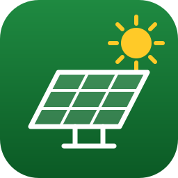
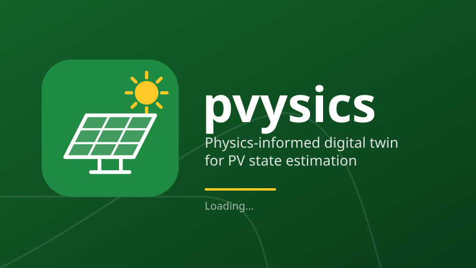

# PV Digital Twin (pvysics)

<p align="center">
  
</p>

<p align="center">
  
</p>

A physics-informed digital twin for PV state estimation, as a runnable desktop prototype.

A Single Diode Model (SDM) of a PV module runs as the **twin**. It predicts power from measured irradiance and temperature. A **simulated plant**, the same module with perturbed parameters, optional faults and sensor noise, stands in for the physical test bench, which does not exist yet. The state estimator compares measured with predicted power (the power deviation) against warning and abnormal limits and reports Normal, Warning or Abnormal.

New to the app? Read the [user manual](docs/user-manual.md).

The prototype is a PyQt6 application with three windows that read the same run:

- **HMI** (PV Digital Twin): Process, Model and Setup tabs (Setup is a list of sections: Profile, Site, Module, Limits and Review). One toolbar for the run and fault injection, a QML strip with the deviation as the hero figure, its rail and the twin's predicted power, the power trend, the SDM circuit and curves, and the run setup.
- **Sensors** (PV Digital Twin Sensors): the plant's own readings (irradiance, module temperature, voltage, current, measured power) with a chart each, apart from the twin. Its Setup tab configures the simulated plant that stands in for hardware (mismatch, sensor noise and quantisation, seed) and the source: the simulated plant or a serial, MQTT or HTTP/WebSocket feed. A hardware feed cannot connect yet (there is no driver); the window says so.
- **Dashboard** (PV Digital Twin Dashboard): a read-only Overview, Alarms and Validation (MAE, RMSE, MAPE, fault-detection scores, CSV export). The Overview is a QML strip of headline figures over a set of chart docks: measured vs predicted power, the deviation, the I-V and P-V curves with the measured operating point, cumulative energy, a histogram of the daylight power deviation (-10 % to +10 % in 0.5 % bins), the time in each state, and the events. Drag a dock to rearrange it, float it (a floating pane is solid, with a green border), tab it with another, or close it and bring it back from View > Panels.

Each window has a log, a pop-up opened from View > Logs (Ctrl+L) and hidden otherwise. It lists what the app is doing as time, level and message, with a level filter, Clear and Copy. Both windows show the same log.

Every chart can be explored: the wheel zooms, a drag pans, and an **Export** button appears at the chart's top right corner while the pointer is over it (image, data as CSV, or reset the view).

The type is Barlow, bundled with the app (SIL Open Font License, in `src/pvysics/gui/fonts/`), with tabular digits so live figures do not jitter. The look is flat, with no boxes: type, space and hairlines on the window. It is green, black, gray and white (the department's colours), in a light and a dark theme that follow the system setting. View > System, Light or Dark overrides it. Amber and red appear only where they mean something: the Warning and Abnormal states, alarms and errors.

The default input is static: the bundled profile is one hourly NASA POWER sample for Durban, and the default module is a generic 60-cell, 250 W datasheet. The Setup tab can also fetch a profile from NASA POWER for a chosen place and dates (see Fetching a profile below). There is no hardware.

The design documents (wireframes, block diagrams, deck) are in `documentation/`. The specification and tickets are in `.scratch/pvysics-prototype/`.

## Requirements

- Python 3.13 (the project pins it in `.python-version`; `requires-python` is `>=3.13`)
- [uv](https://docs.astral.sh/uv/) to manage Python and the dependencies

## Install and run

### Install uv

Linux and macOS:

```sh
curl -LsSf https://astral.sh/uv/install.sh | sh
```

Windows (PowerShell):

```powershell
powershell -ExecutionPolicy ByPass -c "irm https://astral.sh/uv/install.ps1 | iex"
```

Then install Python 3.13 with uv, which keeps it separate from any system Python:

```sh
uv python install 3.13
```

### Run from the repository

These steps are run from the repository root. `uv sync` creates `.venv` and installs the dependencies, including the test tools. `uv run` starts the app.

Linux:

```sh
uv sync
uv run pvysics
```

macOS: the same commands, in Terminal.

Windows: the same commands, in PowerShell.

`uv run pvysics` opens the simple window: one window with a sidebar of pages, in the theme you chose (View > System, Light or Dark).

| Page | What it holds |
| --- | --- |
| Dashboard | the run controls and fault buttons, six readings (voltage, current, measured and predicted power, irradiance, module temperature), the power chart, and the deviation with its state, the limits, peak power, energy, sample count and elapsed time |
| Analysis | *Dataset* (opens first): save an upload template (`.xlsx` or `.csv`), import a CSV or Excel file of measurements, score the twin on it (MAE, RMSE, MAPE, MBE, deviation and state shares), replay it on the Dashboard, export the analysis. *Simulation*: validation of the twin against one healthy day and one day for each fault |
| SDM Model | the circuit, equations, fitted parameters and the live I-V and P-V curves |
| Trends | a chart for each of the five sensor channels |
| Data | every sample of the run as a table, with CSV export |
| Event Log | the alarms (with Acknowledge), the state changes and fault injections, and a button for the application log |
| Live Feed | start a feed that an ESP32 or a logger POSTs readings to (JSON over HTTP, with a token); each reading is scored as it arrives, shown on the Dashboard, and kept in a CSV file |
| Settings | the setup of the next run (profile, site, module, limits); **Apply and start** starts it. A weather profile loads from CSV or Excel, and a module datasheet from Excel, CSV, JSON or TOML. **Template...** buttons save empty files to fill in |

**Templates.** Files to fill in and upload come from a **Template...** button (the dataset on Analysis, the weather profile and the module datasheet on Settings), as `.xlsx` or `.csv`. Ready-made copies are in [`docs/templates/`](docs/templates/): `pvysics-dataset-template`, `pvysics-weather-template` and `pvysics-datasheet-template`.

The Hide button hides the sidebar so a page has the whole window. A ☰ button stays at the top left; it, **View > Sidebar** (`Ctrl+B`) and Esc all bring the sidebar back. There are no window switches.

The advanced version is the app as it was before the simple window: the HMI, the Dashboard and the Sensors window, which also have the Model view, the validation report, the chart docks and the plant setup. Set the environment variable `PVYSICS_ADVANCED_VERSION` to `1` (`true`, `yes` and `on` also work; anything else, or unset, is the simple window):

```sh
PVYSICS_ADVANCED_VERSION=1 uv run pvysics          # Linux, macOS
$env:PVYSICS_ADVANCED_VERSION = "1"; uv run pvysics   # Windows PowerShell
```

In the advanced version the command-line switches open fewer windows:

| Command | Opens |
| --- | --- |
| `uv run pvysics` | all three windows (same as `--all`) |
| `uv run pvysics --hmi` | the HMI only |
| `uv run pvysics --dashboard` | the Dashboard only |
| `uv run pvysics --sensors` | the Sensors window only |
| `uv run pvysics --both` | the HMI and the Dashboard |

The switches exclude each other. An unknown switch, or any switch in the simple version, prints the usage and exits with status 2.

The HMI, the Dashboard and the Sensors window share one run. Closing a window does not stop the run or the other window, and a closed window opens again from the Window menu. The app quits when the last open window closes. A Dashboard opened without the HMI, with no run started, says how to start one.

### Linux Qt library note

Qt's X11 (xcb) platform plugin needs `libxcb-cursor0`. On the build machine (Linux Mint 22.3, Wayland session) `ldd` showed `libxcb-cursor.so.0` missing for the PyQt6 xcb plugin. On Debian, Ubuntu and Mint the package is installed with `sudo apt install libxcb-cursor0`. I did not reproduce the failure that a missing library causes, because the machine has a working Wayland session.

### Run the tests

Linux and macOS:

```sh
QT_QPA_PLATFORM=offscreen uv run pytest
```

Windows (PowerShell):

```powershell
$env:QT_QPA_PLATFORM = "offscreen"; uv run pytest
```

The tests set `QT_QPA_PLATFORM=offscreen` themselves (`tests/conftest.py`), so the variable is optional. The GUI tests need no display.

### Build a wheel

`uv build` writes `dist/`, which is git-ignored. The wheel includes the bundled data and the design assets under `src/pvysics/gui/assets/`.

## Fetching a profile

The Setup tab has a **Fetch profile (NASA POWER)** group. Choose the latitude and longitude (**Use Site location** copies the Site fields; uncheck it to enter other coordinates), the start and end dates, the irradiance (all-sky or clear-sky) and the time standard (local standard time or UTC), then press **Fetch**. The request runs in the background, and **Cancel** discards its result. The fetched profile is staged and shows a one-line summary, and a **preview** of it opens. The preview shows a G chart and a T chart over the whole range (dates along the bottom), the statistics (samples, first and last sample, days, peak G and when it occurs, the peak G of each day, the samples with G above zero, the mean daily energy, and the mean, minimum and maximum T), the source (location, dates, irradiance, time standard, and whether it came from the cache or the network) and the checks it passed. **Use profile** makes it the active profile: the Run summary shows it, and **Apply and start** uses it like a loaded CSV. **Discard** drops it and the active profile stays. Closing the preview with **Close** or Escape leaves the profile staged, and **Preview...** on the Setup tab opens it again. The active profile changes only through **Use profile**. A failed fetch, or one that fails the checks, shows its reason on the Setup tab and in the log, and never opens the preview. The active profile does not change.

A request covers at most 31 days, and the end date cannot be in the future. Responses are cached as raw text under the platform's user cache location, in a `pvysics/pvysics/profiles` folder. On Linux this is `~/.cache/pvysics/pvysics/profiles`. A repeat of the same request is read from the cache with no network access, and the summary says "from cache". A cache file that no longer parses is ignored and fetched again.

## Architecture

- **Headless engine** (`src/pvysics/`, no Qt imports): `single_diode.py` (SDM solver), `profile.py` and `datasheet.py` (inputs), `faults.py`, `run.py` (plant, twin, `Simulation` stepped one Sample at a time), `run_setup.py` (setup checks and derived limits), `alarms.py`, `history.py`, `validation.py` (metrics and the fault batch), `export.py` (CSV), `dataset.py` (measurements imported from a CSV or Excel file, scored by the twin, and the folder they are kept in), `live.py` and `live_server.py` (a device's readings checked and scored as they arrive, and the HTTP endpoint they are posted to), `spreadsheet.py` (reading and writing Excel files for the upload templates, standard library only), `log_model.py` (the bounded log buffer and its level filter), `fetch.py` (the NASA POWER fetch client, its request building, response parsing and disk cache; the transport is injected, so tests never use the network), and `profile_stats.py` (the statistics of a fetched profile for its preview). Tests and scripts call these directly. Modules log through the standard `logging` module under the `pvysics` name.
- **Qt GUI layer** (`src/pvysics/gui/`): `session.py` (the app-level run, history and theme, and the windows it opens), `metric_strip.py` and `qml/MetricStrip.qml` (the figures, drawn in QML), `cli.py` (the command-line switches and the `PVYSICS_ADVANCED_VERSION` flag), `dataset_view.py` (the Dataset Analysis view), `run_toolbar.py` (the run controls and fault buttons, shared by both versions), `simple_window.py`, `simple_pages.py` and `simple_style.py` (the simple window: a sidebar of pages built from the same views, `run_toolbar.py` and `trend.py`), `main_window.py` (HMI), `dashboard.py` (Dashboard), `process_view.py`, `model_view.py`, `setup_view.py` and `validation_view.py` (tabs), `fetch_panel.py` (the Fetch profile group on the Setup tab, which runs fetches on a worker thread), `profile_preview.py` (the preview dialog of a fetched profile), and `playback.py`. `PlaybackController` steps the engine on a `QTimer`, with a simulated clock and selectable speed. The validation batch runs on a `QThread`, so the windows stay responsive. `log_bridge.py` is the one logging handler: it passes records to the UI thread through a Qt signal, and `log_pane.py` is the log pane docked in each window.
- **Data bus** (`gui/data_bus.py`): an in-process `DataBus` of Qt signals (`sample`, `event`, `run_reset`). Both windows subscribe to it through the session, which owns it along with the run. It stands in for the WebSocket and CSV bus in the design. The `Sample` record is the one an ESP32 would publish later.

## Demo script

Use this checklist against the running app. Each step describes what the code does.

**Start**

- [ ] Run `PVYSICS_ADVANCED_VERSION=1 uv run pvysics`. The HMI and the Dashboard open on the same run. (Or add `--hmi` or `--dashboard` for one window. A Dashboard opened alone, before a run, says "No run in progress" and offers **Open HMI**.)

**Setup**

- [ ] Open the Setup tab. The profile list offers the three bundled days, 15 to 17 January 2025. The module is the generic 60-cell, 250 W datasheet, and its values (Isc, Voc, Impp, Vmpp, Ki, Kv and Ns) are editable fields; **Reset to generic module** restores them. A value that fails the checks (for example Vmpp not below Voc, or a module the diode fit cannot fit) is named in the message and logged, and the previous module stays. Edits take effect only on **Apply and start**, and an edited module is named Custom module in the run summary. Defaults: warning limit 5 %, abnormal limit 10 %. The plant defaults (mismatch Rs +3 %, Rsh +5 %, temperature coefficient +2 %; seed 0) are set in the Sensors window's Setup tab.
- [ ] Press **Validate setup**. The message says the setup is valid, or lists what is wrong.
- [ ] Press **Apply and start**. The run restarts from the beginning, the window switches to the Process tab, and the Dashboard follows the new setup.
- [ ] With network access, press **Fetch** in the Fetch profile group. The preview opens with the G and T charts over the range and the statistics. Press **Discard**, then **Preview...**, then **Use profile**: the Run summary names the fetched profile, and **Apply and start** runs it. Without network access the fetch fails with a message and the bundled profile stays active.

**Normal operation**

- [ ] On the Process tab, set **Speed** to 28800x. A day plays in about 3 s; the default 1x is real time.
- [ ] Press **Start** (or **Pause** to stop). The banner shows Normal in green. The plant readings (G, T, V, I, P measured) and the twin's P predicted update on every step.
- [ ] The deviation gauge stays near zero. On the bundled day with defaults the deviation stayed within 2 % (largest 1.9 % at seed 0). Where predicted power is below 5 W (night), the deviation is shown as 0 %.
- [ ] Open the Dashboard Overview. The headline figures (P measured, P predicted, Deviation, State, Energy) and the chart docks fill in. The Events dock is empty while nothing changes. Hover a chart and use **Export** at its top right to save its image or data.

**Fault and alarm**

- [ ] Press **Partial shading** in the toolbar's Inject group. The other four buttons (Soiling, Rs increase, Diode failure, Sensor drift) inject their faults the same way.
- [ ] The state goes **Abnormal** (red) on the next step. Open the Dashboard's Alarms tab: a new alarm appears with its time, ABNORMAL, the deviation, and the cause, partial shading. Its row is bold and tinted until it is acknowledged.
- [ ] The Dashboard event list shows the fault and the state change, as "Fault: none -> partial shading" and "State: Normal -> Abnormal".
- [ ] Select the alarm and press **Acknowledge**. The row turns grey and is marked "(seen)".

I measured this with the faults injected at 10:00 on the bundled day at the default severities: each fault went to Abnormal at the first step after injection.

**Recovery**

- [ ] Press **Clear all**. The faults are removed, and the state returns to Normal on the next step. The alarm stays in the list. Only **Reset** or **Apply and start** clears the list.
- [ ] Optional: press **Reset**. The run starts again from its first sample, paused, with no faults and an empty alarm list.

**Log**

- [ ] Open **View > Logs** in each window. The pop-up lists the actions as time, level and message, for example "Run started", "Fault injected" and "Alarm Abnormal". Both windows show the same lines.
- [ ] Choose **Warning** in **Level**: only warnings and errors remain. Choose **Info** again and the hidden lines return. **Clear** empties the log in both windows. **Copy** puts the visible text on the clipboard.
- [ ] Load a CSV or datasheet that the checks reject (for example a file with no header row). A WARNING line gives the same reason as the message on the Setup tab.
- [ ] Press the **Log** button in the pane's header to collapse the list to its header row, and press it again to show the list.

**Model**

- [ ] Open the Model tab. It shows the SDM circuit and three equations, the parameters in use (Iph at STC, Rs, Rsh, n, Ns), the module datasheet values, the live G, T, V and I, P predicted, the model Pmpp and the deviation.
- [ ] The I-V and P-V curves are computed for the measured G and T. The measured operating point is marked on both. The curves are recomputed when G or T changes.

**Validation (Dashboard)**

- [ ] Open the Validation tab in the Dashboard window and press **Run validation**. It runs one healthy run and five fault runs in the background, which takes a few seconds. The button is disabled while it runs.
- [ ] Check the error metrics. On the bundled day with defaults the build machine measured MAE 0.24 W, RMSE 0.35 W and MAPE 0.47 % over 702 daylight samples.
- [ ] Check the fault detection. The confusion matrix has rows for truth (normal, fault) and columns for the estimated state. Each of the five faults has a detection delay and a detection rate. On the bundled day the delay was 0 s and the rate 100 % for every fault.
- [ ] Check the false-alarm rates. With the config thresholds (5 % and 10 %) the rate was 0.0 %. With the derived thresholds (mean + 2 and 3 standard deviations) it was 4.3 %.
- [ ] Press **Export samples CSV...** or **Export metrics CSV...** to save the results.

## Known limitations

**Platforms tested**

- Tested: Linux Mint 22.3, x86_64, Python 3.13.15, PyQt6 6.11.0 (Qt 6.11.0). The full test suite passed offscreen. The wheel built and installed in a clean virtual environment, with the bundled data loading from it. `uv run pvysics` stayed up for the full 8 s `timeout` on the desktop session.
- Not tested: **Windows** and **macOS**. I did not run the app, the tests, the uv install, or the PowerShell command on either. The uv install commands above come from the uv documentation, not from a run.
- Not tested on any platform: clicking through the windows by hand on a real display, native file dialogs, and high-DPI on real hardware. High-DPI scaling is on by default in Qt 6, and nothing in the code sets a fixed scale; with `QT_SCALE_FACTOR=2` offscreen the device pixel ratio became 2.0.

**Model and validation**

- **Derived thresholds produce false alarms on healthy data.** The derived limits (mean + 2 and mean + 3 standard deviations of the healthy deviation) assume the deviation is roughly Gaussian. It is not: on the bundled day the healthy absolute deviation has a median of 0.41 % and a 90th percentile of 0.97 %, and its maximum is 1.9 %. The 2-sigma warning limit (1.18 %) is exceeded by 4.3 % of daylight samples. The default 5 % and 10 % limits gave 0 % on the same run.
- **Fault detection scores are perfect by construction.** Validation injects each fault as a severe step change at 10:00 on the first bundled day, at the default severity, held for one hour. A step is detected at once, so the delay is 0 s, the detection rate 100 % and the confusion matrix is diagonal. Gradual real faults would not score this well. The scores do not show how the twin performs on other times, severities or profiles.
- **The plant and the twin are the same model family.** Both are an SDM built from the same datasheet, so the healthy error comes from the chosen mismatch (Rs, Rsh, temperature coefficient) and the sensor noise. MAE, RMSE and MAPE show how well the twin matches the simulated plant. They say nothing about accuracy against a real module.
- Metrics and the confusion matrix use daylight samples only, where predicted power is at least 5 W. MAPE also skips samples where measured power is below 5 W.
- The bundled data is hourly NASA POWER values, linearly interpolated to a 60 s step.

**Scope and deferred items**

- Live fetching is NASA POWER only, for hourly point data, one point and at most 31 days per request. PVGIS is not supported. The bundled sample stays the offline default and the fallback: with no network, the bundled days still load and run.
- **Datasets and Excel.** A dataset is scored with the twin's nominal parameters from the rows' own irradiance and temperature, so it has no hidden truth and no injected faults. Only the first sheet of an `.xlsx` is read, and `.xls` is not supported. Imported datasets are copied into the user's data folder (`$XDG_DATA_HOME/pvysics/datasets` on Linux, `%APPDATA%\pvysics\datasets` on Windows, or `PVYSICS_DATASETS_DIR`) and are never removed except by **Delete dataset**. Replaying a dataset replaces the run in every window until a new run is applied.
- No sun position or plane-of-array irradiance. A device can post readings to the Live Feed (`live.py`, `live_server.py`: plain HTTP with a token, no encryption), but there is no serial or MQTT link, and the ESP32 example sketch in `docs/esp32/` has not been run on hardware. The in-process Qt signal bus stands in for the design's network bus.
- Site fields (latitude, longitude, tilt, azimuth) are metadata only. They are stored and shown in the run summary and never enter the physics.
- One module only: no strings, arrays, MPPT or load modelling. A simulated run reads the plant at its own maximum power point (an ideal-tracker assumption) and predicts the maximum power. An imported dataset with voltage and current is predicted at the measured voltage; a power-only file is compared with the maximum power. The diode ideality factor is fixed at 1.3.
- Fault severity is fixed at the defaults. The Setup screen cannot schedule faults; `RunConfig` accepts scheduled faults, but the Setup controls never fill them in.
- Alarms persist after **Clear all** and are cleared only by **Reset** or **Apply and start**.
- The Validation tab uses the setup that was last applied. After a change to the setup, the old result is marked stale until validation is run again.
- The time step is fixed at 60 s and is not a control in the app.
- Closing the Dashboard while a validation runs waits for the batch to finish, a few seconds at most.
- Machine learning fault classification is out of scope, as are installers and code signing. Run from source with uv is the supported path.

## Building an installable app

The packaged app bundles Python, Qt and every data file, so the target device needs no Python.

```
uv run --group build python packaging/build.py
```

PyInstaller cannot cross-compile, so run it on each platform you are packaging for. `packaging/release.sh` runs the tests, builds, writes `dist/SHA256SUMS` and prints the `gh release create` command to upload the files. Output goes to `dist/`:

- Debian and derivatives: `pvysics_<version>_amd64.deb`, installed with `sudo apt install ./pvysics_*.deb`. It needs glibc at least as new as the build machine's (stated in its Depends), so build on the oldest Debian-family release you support.
- Other Linux: `pvysics-<version>-linux-x86_64.tar.gz`. Unpack it and run `./install.sh` (per user, or `sudo PREFIX=/opt ./install.sh`).
- Windows: `pvysics-<version>-windows.zip` (unzip it and run `pvysics\pvysics.exe`), plus a `-setup.exe` installer when Inno Setup (`iscc`) is installed. Neither is code-signed, so Windows may warn on first run (*More info*, then *Run anyway*).
- macOS: `pvysics-<version>-macos.dmg`. It is unsigned, so the first launch needs right-click, Open.

### Building the Windows app from Linux

You do not need a Windows machine. One command starts a real Windows 11 in a container, builds the app inside it and copies
the zip and the setup exe into `dist/`:

```sh
git status                                  # the build uses the last commit, so commit what you want in it first
packaging/windows/vm/build-from-linux.sh
```

- **Needs** `docker` (or `podman`), `/dev/kvm` that you can use, 8 GB of RAM, 4 cores, up to 64 GB of disk and a network
  connection. Windows is downloaded from Microsoft, whose licence terms apply.
- **Takes** about 25 minutes the first time, while Windows installs, and about 10 minutes after that. The Windows disk is kept
  (`~/.cache/pvysics-winbuild/storage`), and the container is stopped, not deleted, when the build ends.
- **Builds the last commit** (`git archive HEAD`), not your working tree.
- **Watch it** at <http://127.0.0.1:8006>, or follow `~/.cache/pvysics-winbuild/shared/build.log`.
- **Reuse a Windows disk you already have** with `STORAGE=/path/to/storage packaging/windows/vm/build-from-linux.sh`. Without
  it the script installs Windows again.
- **Order matters.** `packaging/build.py` and `packaging/release.sh` empty `dist/` when they start, so run them first, then the
  Windows script, then write the checksums: `cd dist && sha256sum *.tar.gz *.deb *.zip *-setup.exe | tee SHA256SUMS`.

On a Windows machine, run `uv run --group build python packaging/build.py` instead. [`packaging/windows/vm/README.md`](packaging/windows/vm/README.md)
explains what the script does step by step, its settings, how to clean up, and what to check when a build misbehaves.
