# PV Digital Twin: User Manual

This manual shows how to run the simulated PV plant and its digital twin, set up a run, inject faults and read the results. No hardware is needed: the plant is simulated.

**Contents**

1. [What the system does](#1-what-the-system-does)
2. [Starting the app](#2-starting-the-app)
3. [The HMI](#3-the-hmi)
4. [The Dashboard](#4-the-dashboard)
5. [The Sensors window](#5-the-sensors-window)
6. [Setting up a run](#6-setting-up-a-run)
7. [Loading your own data](#7-loading-your-own-data)
8. [Themes and the log](#8-themes-and-the-log)
9. [Quick recipes](#9-quick-recipes)
10. [Troubleshooting](#10-troubleshooting)

---

## 1. What the system does

The app runs two models side by side over a day of sunlight and temperature:

- **The plant** is a simulated PV module with sensor noise and a small mismatch from the datasheet. It stands in for the real hardware.
- **The twin** predicts the module's power from the measured irradiance and temperature, using the single diode model.

The **deviation** is how far the plant's measured power is from the twin's prediction, in percent. When it passes a limit the **state** changes:

| State | Meaning |
|---|---|
| **Normal** | Deviation is inside the warning limit. |
| **Warning** | Deviation has passed the warning limit. |
| **Abnormal** | Deviation has passed the abnormal limit. An alarm is raised. |

You can inject faults into the plant (shading, soiling and so on) and watch the twin catch them.

There are two windows. The **HMI** is where you drive the run. The **Dashboard** is a read-only view of the same run, with charts and a validation report.

## 2. Starting the app

From the repository root:

```
uv run pvysics
```

The HMI, the Dashboard and the Sensors window open together on the same run. To open fewer, use `uv run pvysics --hmi`, `--dashboard`, `--sensors` or `--both` (the HMI and the Dashboard). A closed window comes back from the **Window** menu. The app quits when the last window closes.

## 3. The HMI

The HMI has four tabs: **Process**, **Model**, **Setup** and **Alarms**.

### 3.1 Process

This is where you run the simulation.

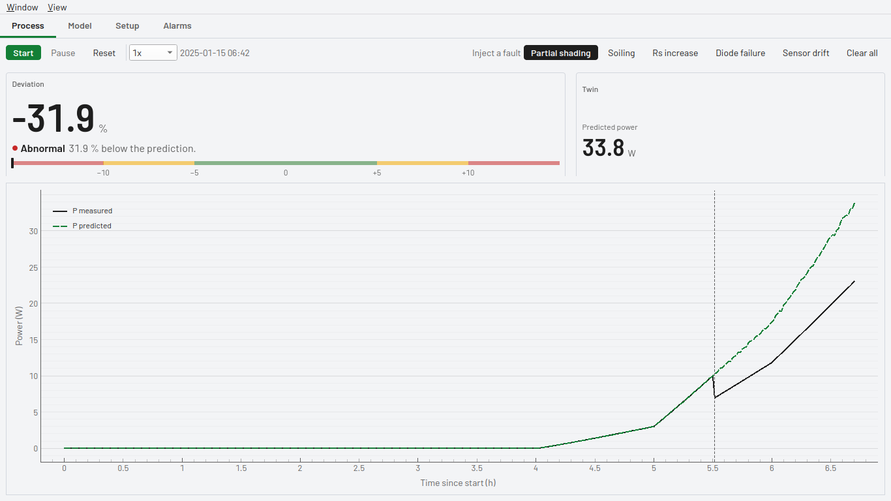

**Toolbar** (the row at the top)

| Control | What it does |
|---|---|
| **Start** | Plays the run from the beginning, or resumes it after a pause. |
| **Pause** | Holds the run where it is. |
| **Reset** | Clears the run so it can start again. |
| **Speed** (`1x` to `28800x`) | How many times faster than real time the run plays. At 28800x a whole day plays in about 3 seconds. |
| Clock | The simulated date and time of the current sample. |
| **Inject a fault** buttons | Partial shading, Soiling, Rs increase, Diode failure, Sensor drift. Click one to inject that fault into the plant. A fault that is on shows as a dark button. Use **Clear all** to remove faults. |
| **Clear all** | Removes every injected fault. |

**Figures**

| Group | Shows |
|---|---|
| Deviation | The largest figure on the screen: how far the plant is from the twin, in percent. Under it, the state in words, and a rail with the limits (zero in the middle, warning and abnormal either side) and a marker for where the deviation is now. |
| Twin | Predicted power from the twin |

The plant's measured readings (power, irradiance, module temperature, voltage and current) are on the Dashboard. The chart below plots measured against predicted power.

**The chart** plots measured power (black) against predicted power (green, dashed). A dashed vertical line marks a fault injection.

**Alarms** have a tab of their own, next to Setup: time, state, deviation and probable cause. Press **Acknowledge** to mark one as seen.

### 3.2 Model

This tab shows what the twin is computing.

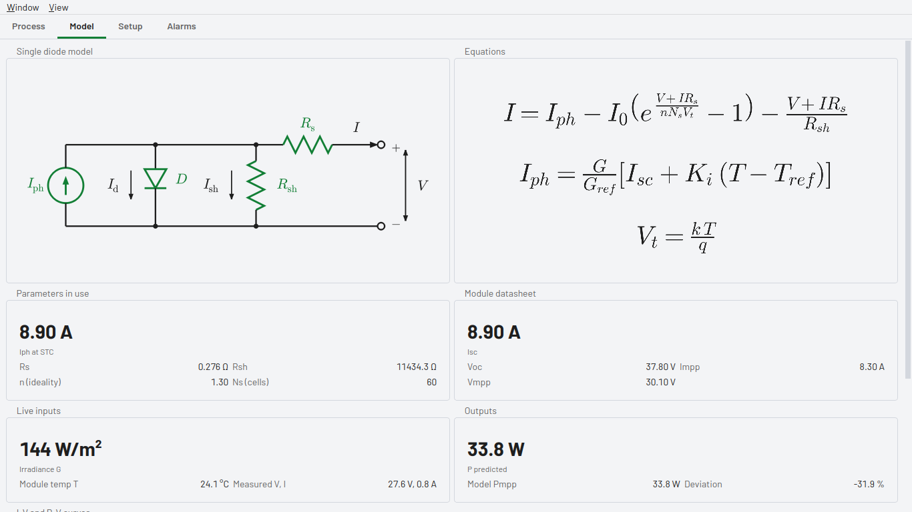

- The **circuit** of the single diode model and its **equations**.
- **Parameters in use**: the photocurrent, series and shunt resistance and ideality factor that the twin fitted from the datasheet.
- **Module datasheet**, **Live inputs** and **Outputs**: the values going in and the power coming out for the current sample.
- Below these, the **I-V and P-V curves** at the measured irradiance and temperature.

### 3.3 Setup

Setup holds the settings for the next run: the profile, the site, the module and the limits. The simulated plant is set up in the [Sensors window](#5-the-sensors-window).

## 4. The Dashboard

Use the Dashboard to watch a run. It changes nothing.

### 4.1 Overview

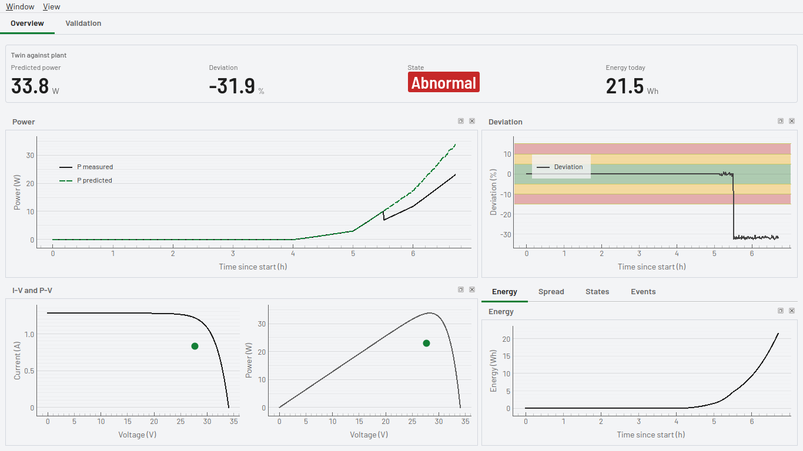

- **The figures at the top** show predicted power, deviation, the state and the energy produced so far. The plant's own readings are in the [Sensors window](#5-the-sensors-window).
- **Each chart is a dock.** Drag its title to rearrange it, press the small button at its top right to float it, or close it. **View > Panels** brings any dock back.
- The charts are power (measured against predicted), deviation, the I-V and P-V curves, and (tabbed together) energy, the deviation spread, the time in each state and the events.

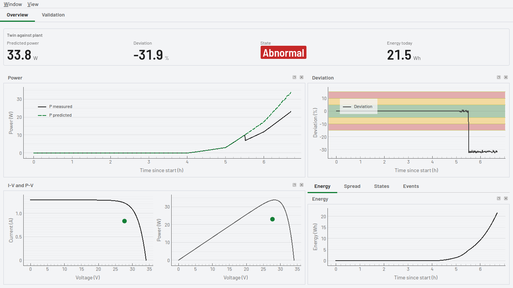

If you open the Dashboard before a run, it says there is no run in progress and offers **Open HMI**.

### 4.2 Exploring and exporting a chart

Every chart can be explored:

- The mouse wheel zooms and a drag pans.
- While the pointer is over a chart, an **Export** button appears at its top right corner. It offers **Image (PNG)...**, **Data (CSV)...** and **Reset view**.

### 4.3 Validation

Validation tests the twin against known answers. It runs one healthy day and one day for each of the five faults.

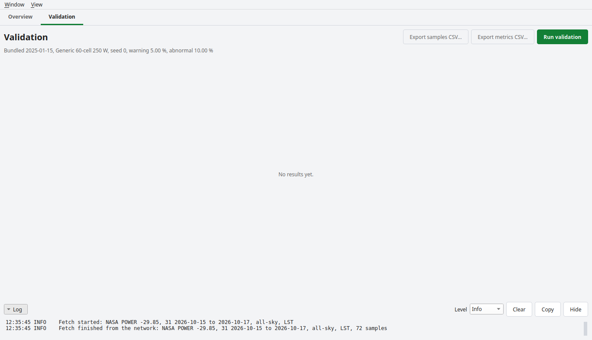

Press **Run validation**. 

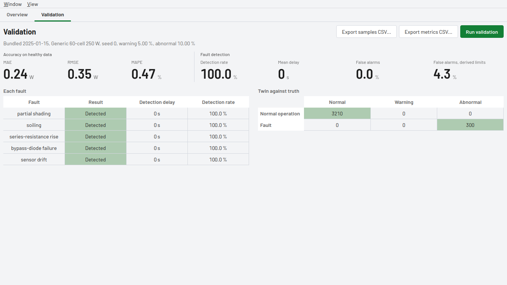

| Result | What it tells you |
|---|---|
| **MAE, RMSE, MAPE** | How closely the twin's power matches the healthy plant. Hover the figures for what is excluded. |
| **Detection rate** | The share of fault samples the twin flagged as Abnormal. |
| **Mean delay** | How long after injection the twin noticed. |
| **False alarms** | How often the healthy run was flagged, at your configured limits and at limits derived from the healthy run's own noise. |
| **Each fault** | Whether each of the five faults was detected, how fast, and at what rate. |
| **Twin against truth** | A table of what was true (rows) against what the twin said (columns). Green cells are correct. |

**Export samples CSV...** and **Export metrics CSV...** save the data behind the results.

## 5. The Sensors window

The Sensors window holds everything that comes from the plant's own sensors, apart from the twin. Today the source is the simulated plant. When hardware feeds are added, this is the window where they connect, and the figures and charts here do not change.

**Live** shows the five sensor readings (irradiance, module temperature, voltage, current and measured power) and a chart for each channel. Irradiance and module temperature are tabs in one pane. The header says where the readings come from and whether hardware is connected.

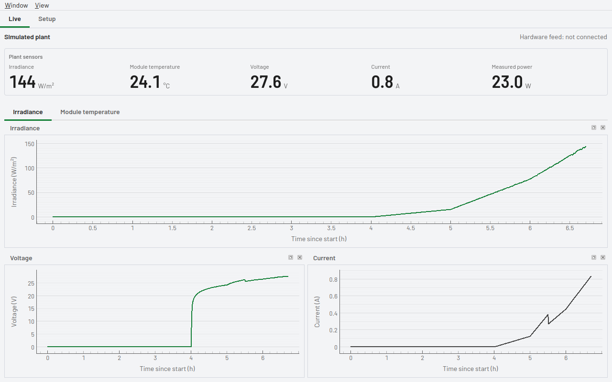

**Setup** has two parts.

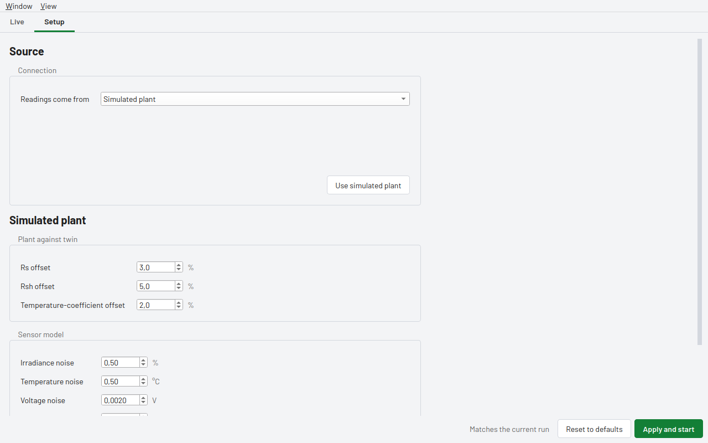

- **Source.** Choose where the readings come from: the simulated plant, a serial port, an MQTT broker, or an HTTP or WebSocket address. A hardware source shows its connection settings (port and baud rate, host and topic, or an address) and the **Channels**: the field name each reading arrives under. **Connect** checks the settings and names anything missing. There is no hardware driver in this version, so Connect says so, the header shows "not available yet", and the simulated plant stays the source.

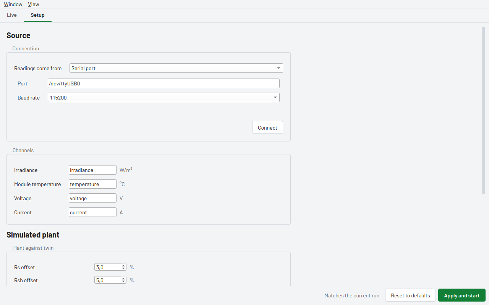

- **Simulated plant.** How far the simulated module differs from the twin's datasheet (the **Rs**, **Rsh** and temperature-coefficient offsets: a larger mismatch makes a larger healthy deviation), and the **Sensor model**: the noise on each sensor, the step size of the voltage and current readings, and the random **Seed**. The same seed gives the same run every time. **Apply and start** starts a new run with this plant.

## 6. Setting up a run

Open the HMI's **Setup** tab. The sections are listed on the left. Click one to see its page.

Nothing changes until you press **Apply and start**. The bar along the bottom shows whether your edits differ from the current run ("Matches the current run" or unapplied changes). It also holds three buttons:

| Button | What it does |
|---|---|
| **Validate setup** | Checks every value and reports problems. It starts nothing. |
| **Reset to defaults** | Puts every control back to its default. It applies nothing. |
| **Apply and start** | Checks the setup and starts a new run from the beginning. |

Each number field holds only the number. Its unit is the grey label beside it.

### 6.1 Profile

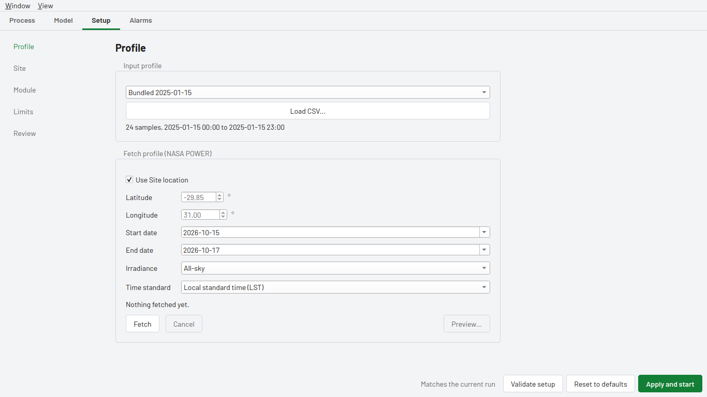

The profile is the day of irradiance and temperature that drives the run.

- Choose a bundled day from the list, or press **Load CSV...** for your own file ([section 7](#7-loading-your-own-data)).
- **Fetch profile (NASA POWER)** downloads real data for a place and dates. Tick **Use Site location** to use the latitude and longitude from the Site page, or untick it to type your own. Choose the start and end dates, the irradiance type and the time standard, then press **Fetch**. **Preview...** shows the fetched data before you use it. Fetches are cached, so a repeat fetch works offline.

### 6.2 Site

Where the plant is (latitude, longitude, tilt and azimuth). It labels the run and sets the default fetch position. It does not change the physics.

### 6.3 Module

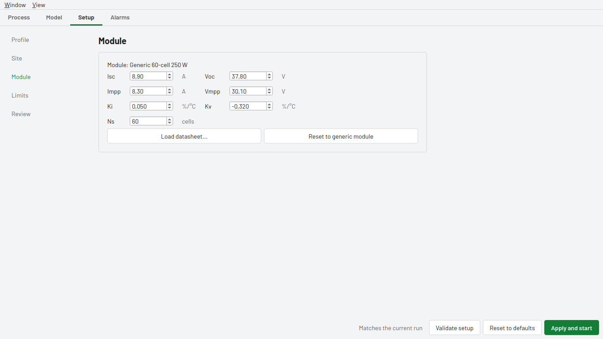

The datasheet the twin predicts with: Isc, Voc, Impp, Vmpp, the temperature coefficients Ki and Kv, and the cell count Ns. Edit any value, press **Load datasheet...** to read a file, or press **Reset to generic module** to return to the generic 60-cell 250 W module.

### 6.4 Limits

The warning and abnormal limits, in percent. **Derive from healthy run** sets them from a healthy simulated day: the mean deviation plus two and three standard deviations.

### 6.5 Review

A summary of what the next run will use. Check it, then press **Apply and start**.

## 7. Loading your own data

Press **Load CSV...** on the Profile page and choose a file. The file needs a header row, a timestamp column, an irradiance column (W/m²) and a temperature column (°C).

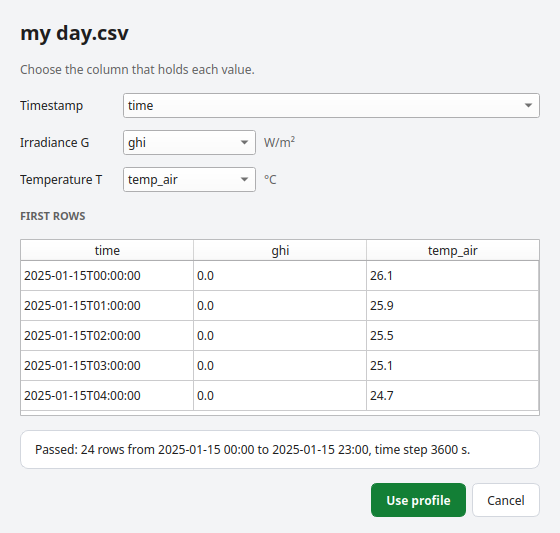

1. The dialog guesses each column from its name. Change a choice if it is wrong. NASA POWER files with `YEAR, MO, DY, HR` columns are recognised.
2. The **first rows** table shows what the file holds.
3. The check line says **Passed** with the number of rows, the date range and the time step, or **Rejected** with the reason.
4. **Use profile** is enabled only when the file passes. Press it, then **Apply and start**. **Cancel** keeps the previous profile.

A file is rejected if its times do not increase by one fixed step, any value is missing or not a number, or irradiance is negative.

When you fetch from NASA POWER, **Preview...** opens the fetched profile for inspection before it is used.

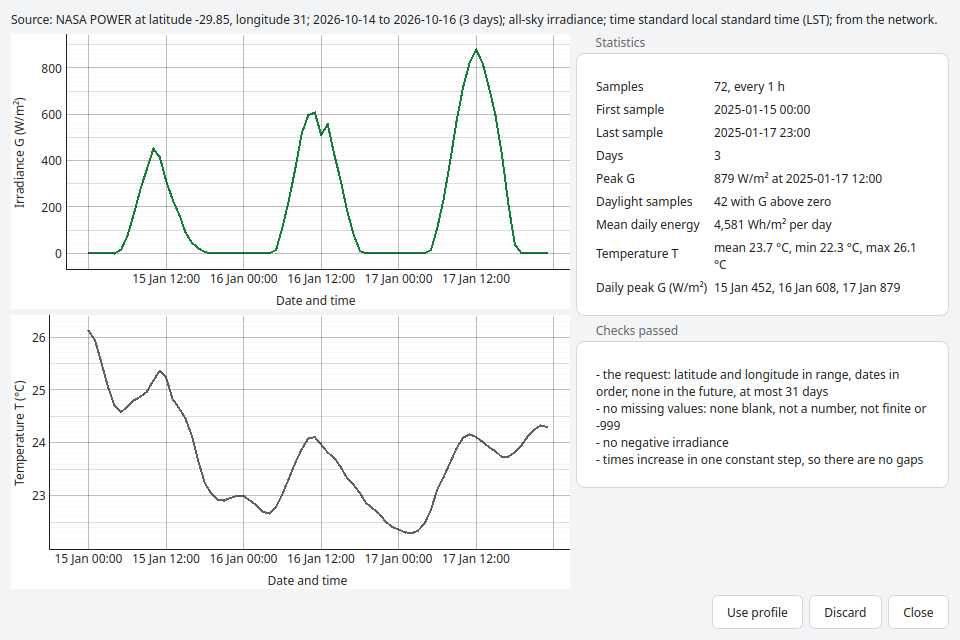

## 8. Themes and the log

**Themes.** The app follows your system's light or dark setting. In the **View** menu, choose **System**, **Light** or **Dark** to override it. The look is flat: no boxes, only type, space and thin rules.

| Light | Dark |
|---|---|
| 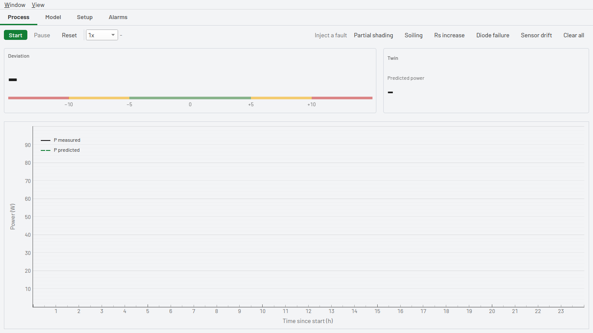 | 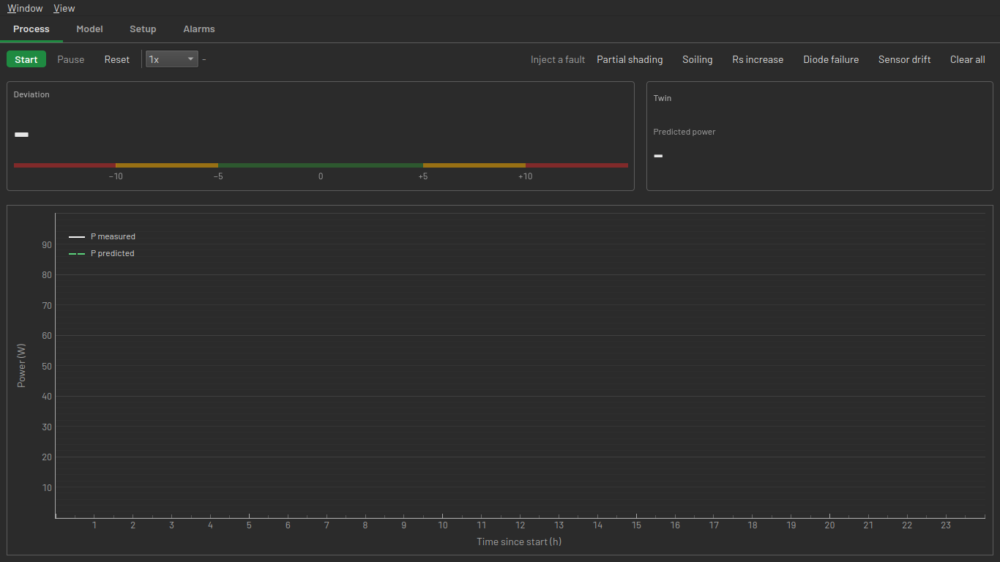 |
|  | 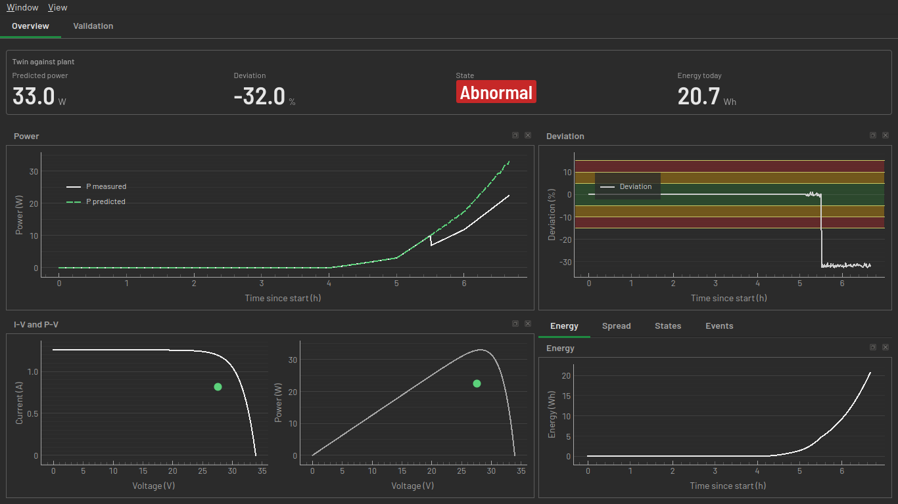 |

**The log.** Open it from **View > Logs** (Ctrl+L). It is a pop-up window, so it takes no room until you ask for it; close it with its close button. It lists what the app is doing as time, level and message.

- **Level** filters by Debug, Info, Warning or Error. Warnings are amber and errors are red.
- **Clear** empties it, and **Copy** puts the visible lines on the clipboard.

Both windows show the same log.

## 9. Quick recipes

**Watch a fault being caught**

1. Run `uv run pvysics`.
2. In the HMI, set the speed to `600x` and press **Start**.
3. Once the plant output has risen, click **Partial shading**.
4. Watch the deviation figure and bar, the state pill and the alarm. The Dashboard shows the same event.

**Run on real weather**

1. Setup > Site: enter the plant's latitude and longitude.
2. Setup > Profile: pick dates, press **Fetch**, press **Preview...**, then **Use**.
3. Press **Apply and start**.

**Check the twin's accuracy**

1. Open the Dashboard and go to **Validation**.
2. Press **Run validation** and read the figures and tables.
3. Use **Export metrics CSV...** to keep the numbers.

**Start over**

Setup > **Reset to defaults**, then **Apply and start**.

## 10. Troubleshooting

| Problem | What to do |
|---|---|
| The Dashboard says "No run in progress". | Press **Open HMI** and start a run there. |
| A CSV is rejected. | Read the reason in the dialog. Check that the columns are mapped right and the times step evenly with no gaps. |
| A fetch fails. | NASA POWER needs an internet connection. The log has the reason. A date range you fetched before still loads from the cache. |
| The state stays Normal after injecting a fault. | At night there is too little light to compare, so no state is shown. Run on until the sun is up. |
| Changes on Setup have no effect. | Press **Apply and start**. Edits apply only then. |
| The log is not showing. | It is a pop-up: **View > Logs** (Ctrl+L). On the Dashboard, a closed chart comes back from **View > Panels**. |
