# PV Digital Twin: User Manual

This manual shows how to run the simulated PV plant and its digital twin, set up a run, inject faults and read the results. No hardware is needed: the plant is simulated.

**Contents**

1. [What the system does](#1-what-the-system-does)
2. [Starting the app](#2-starting-the-app)
3. [The HMI](#3-the-hmi)
4. [The Dashboard](#4-the-dashboard)
5. [The Sensors window](#5-the-sensors-window)
6. [Setting up a run](#6-setting-up-a-run)
7. [Loading your own data](#7-loading-your-own-data)
8. [Themes and the log](#8-themes-and-the-log)
9. [Quick recipes](#9-quick-recipes)
10. [Troubleshooting](#10-troubleshooting)

---

## 1. What the system does

The app runs two models side by side over a day of sunlight and temperature:

- **The plant** is a simulated PV module with sensor noise and a small mismatch from the datasheet. It stands in for the real hardware.
- **The twin** predicts the module's power from the measured irradiance and temperature, using the single diode model.

The **deviation** is how far the plant's measured power is from the twin's prediction, in percent. When it passes a limit the **state** changes:

| State | Meaning |
|---|---|
| **Normal** | Deviation is inside the warning limit. |
| **Warning** | Deviation has passed the warning limit. |
| **Abnormal** | Deviation has passed the abnormal limit. An alarm is raised. |

You can inject faults into the plant (shading, soiling and so on) and watch the twin catch them.

There are three windows on one run:

| Window | What it is for |
|---|---|
| **HMI** | Drive the run: start, pause, inject faults, set up the run. Shows the deviation and the twin's prediction. |
| **Dashboard** | Watch the comparison: charts, alarms, the event list and the validation report. Read-only. |
| **Sensors** | The plant's own readings, and the setup of the plant and its source. When hardware is added, it connects here. |

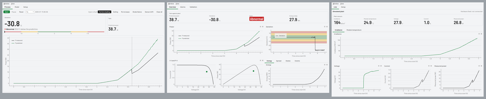

*Figure 1. The three windows on one run: the HMI, the Dashboard and the Sensors window (left to right).*

## 2. Starting the app

From the repository root:

```
uv run pvysics
```

This opens the **simple window**: one window with a sidebar of pages, in the theme you chose (**View > System**, **Light** or **Dark**).

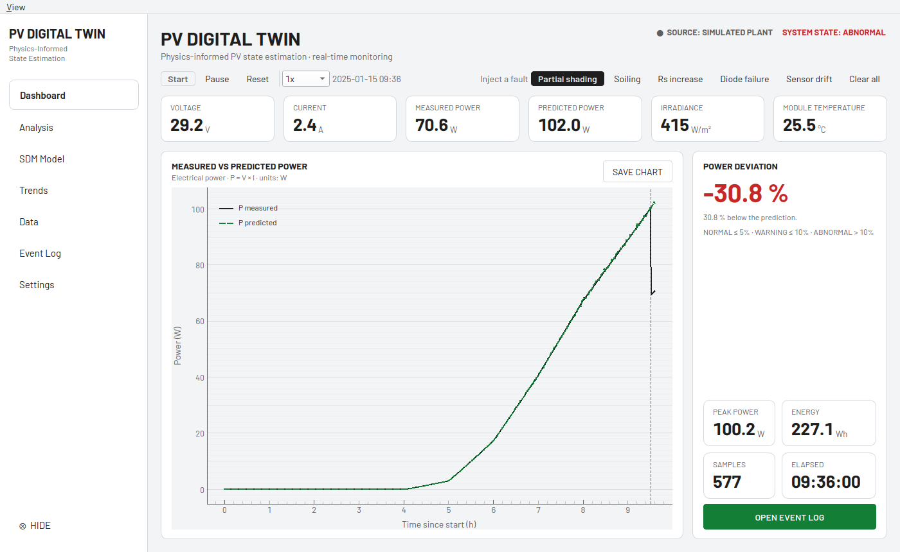

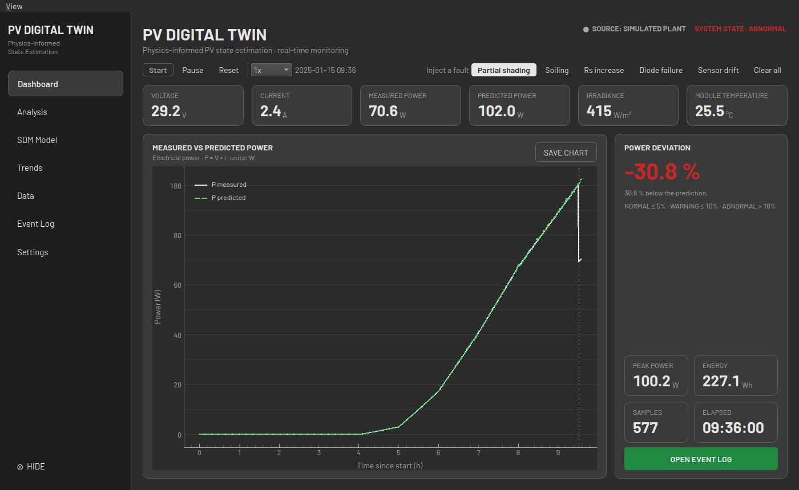

| Page | What it holds |
|---|---|
| **Dashboard** | The run controls and fault buttons, six readings, the power chart, and the deviation with its state, the limits, peak power, energy, sample count and elapsed time. **Open event log** goes to the Event Log page. |
| **Analysis** | Validation: the twin against one healthy day and one day for each fault (section 4.5). |
| **SDM Model** | The circuit, equations, fitted parameters and live I-V and P-V curves (section 3.2). |
| **Trends** | A chart for each of the five sensor channels. |
| **Data** | Every sample of the run as a table, newest first. **Export CSV** saves the whole run. |
| **Event Log** | The alarms, with **Acknowledge**, the state changes and fault injections, and **Show log** for the application log. |
| **Settings** | The setup of the next run (chapter 6). **Apply and start** starts it and returns to the Dashboard. |

**Hide** hides the sidebar so a page has the whole window. A ☰ button stays at the top left; it, **View > Sidebar** (**Ctrl+B**) and **Esc** all bring the sidebar back.

The simple window has its own manual (`user-manual-simple.typ`). The rest of this manual describes the **advanced version**: the HMI, the Dashboard and the Sensors window, which add the Model view, validation, chart docks and the plant setup. To start it, set the environment variable `PVYSICS_ADVANCED_VERSION` to `1` (`true`, `yes` and `on` also work):

```
PVYSICS_ADVANCED_VERSION=1 uv run pvysics
```

In PowerShell, set `$env:PVYSICS_ADVANCED_VERSION = "1"` first. All three windows then open together on the same run. The switches below work only in the advanced version; the simple window takes none.

| Command | Opens |
|---|---|
| `uv run pvysics` or `--all` | the HMI, the Dashboard and the Sensors window |
| `--hmi` | the HMI only |
| `--dashboard` | the Dashboard only |
| `--sensors` | the Sensors window only |
| `--both` | the HMI and the Dashboard |

A closed window comes back from the **Window** menu. The app quits when the last window closes.

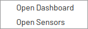

*Figure 2. The Window menu opens the other windows.*

## 3. The HMI

The HMI has three tabs: **Process**, **Model** and **Setup**.

### 3.1 Process

This is where you run the simulation. Before a run starts the figures are empty and the chart shows a day.

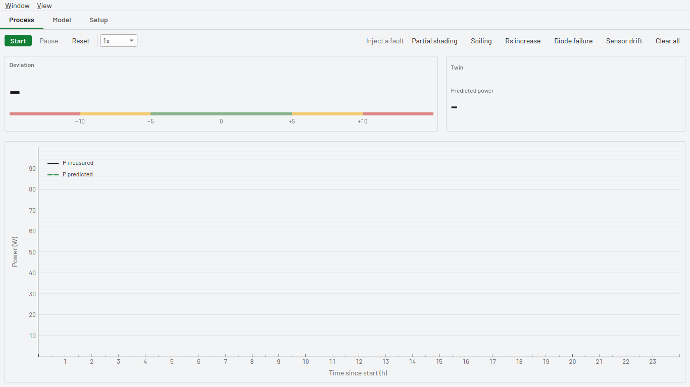

*Figure 3. The Process tab before a run: the toolbar, the empty deviation figure with its rail, and the power chart.*

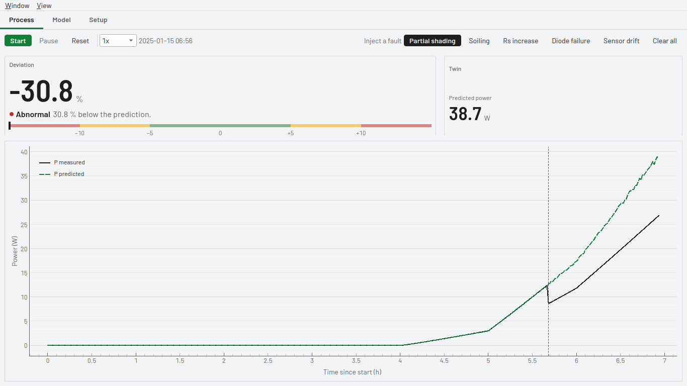

*Figure 4. The Process tab during a run with partial shading injected: the deviation is -31.9 %, the state is Abnormal and the chart shows measured power falling away from the prediction.*

**Toolbar** (the row at the top)

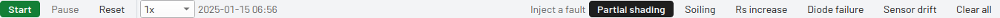

*Figure 5. The toolbar: run controls, speed and clock on the left, fault injection on the right. The dark button is a fault that is on.*

| Control | What it does |
|---|---|
| **Start** | Plays the run from the beginning, or resumes it after a pause. |
| **Pause** | Holds the run where it is. |
| **Reset** | Clears the run so it can start again. |
| **Speed** (`1x` to `28800x`) | How many times faster than real time the run plays. At 28800x a whole day plays in about 3 seconds. |
| Clock | The simulated date and time of the current sample. |
| **Inject a fault** buttons | Partial shading, Soiling, Rs increase, Diode failure, Sensor drift. Click one to inject that fault into the plant. A fault that is on shows as a dark button. |
| **Clear all** | Removes every injected fault. |

**Figures**

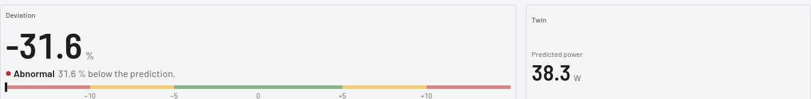

*Figure 6. The figures: the deviation as the largest number, the state in words under it, a rail with the limits and a marker at the current deviation, and the twin's predicted power.*

| Group | Shows |
|---|---|
| Deviation | The largest figure on the screen: how far the plant is from the twin, in percent. Under it, the state in words, and a rail with the limits (zero in the middle, warning and abnormal either side) and a marker for where the deviation is now. |
| Twin | Predicted power from the twin |

The plant's measured readings (power, irradiance, module temperature, voltage and current) are in the [Sensors window](#5-the-sensors-window). Alarms are on the [Dashboard](#4-the-dashboard).

**The chart** plots measured power (black) against predicted power (green, dashed). A dashed vertical line marks a fault injection. The wheel zooms and a drag pans. While the pointer is over the chart an **Export** button appears at its top right corner.

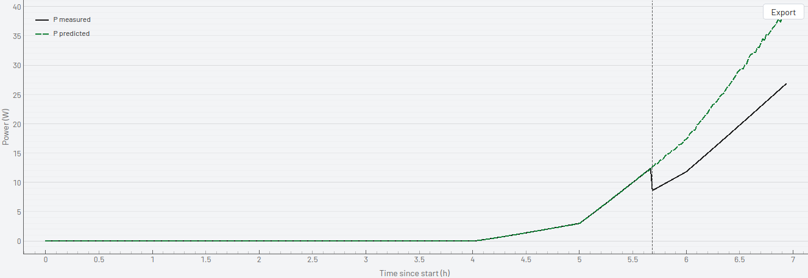

*Figure 7. The Export button, at the top right of a chart while the pointer is over it.*

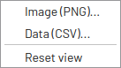

*Figure 8. The Export menu: save the chart as an image or as CSV data, or reset the view to the whole chart.*

### 3.2 Model

This tab shows what the twin is computing: the circuit of the single diode model and its equations, the parameters the twin fitted from the datasheet, the live inputs and outputs, and the I-V and P-V curves at the measured irradiance and temperature.

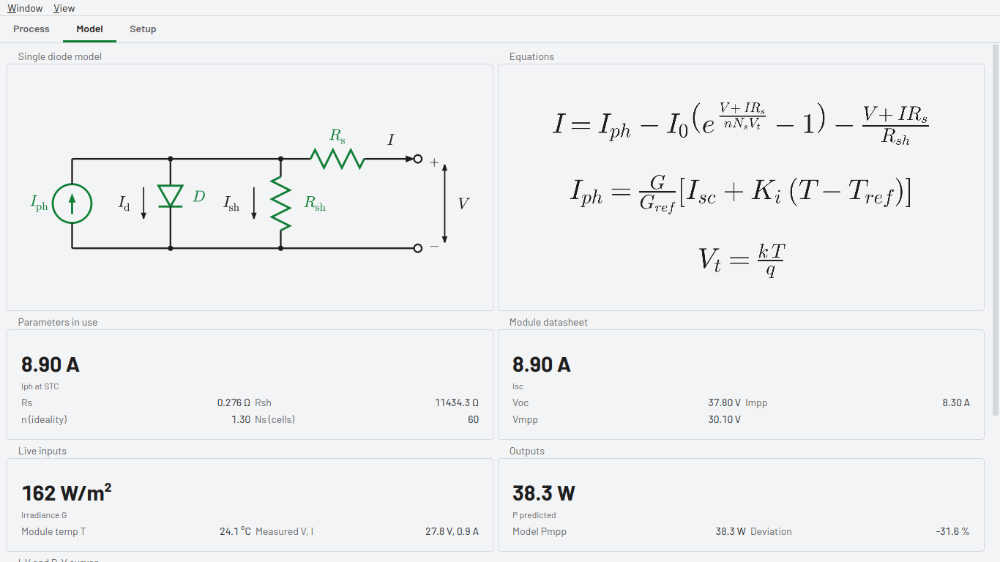

*Figure 9. The Model tab: the circuit, the equations, four groups of readings and, below them, the I-V and P-V curves.*

### 3.3 Setup

Setup holds the settings for the next run: the profile, the site, the module and the limits. The simulated plant is set up in the [Sensors window](#5-the-sensors-window). Section 6 describes each page.

## 4. The Dashboard

Use the Dashboard to watch a run and its alarms. It changes nothing. Its tabs are **Overview**, **Alarms** and **Validation**.

### 4.1 Overview


*Figure 10. The Dashboard overview: headline figures on top and a chart in each dock below.*

- **The figures at the top** show predicted power, deviation, the state and the energy produced so far.
- **Each chart is a dock.** Drag its title to rearrange it, press the small button at its top right to float it, or close it.
- The charts are power (measured against predicted), deviation, the I-V and P-V curves, and (tabbed together) energy, the deviation spread, the time in each state and the events.

The tabbed pane holds four charts. Click a tab to bring one forward.


*Figure 11. The Energy tab: cumulative energy over the run.*

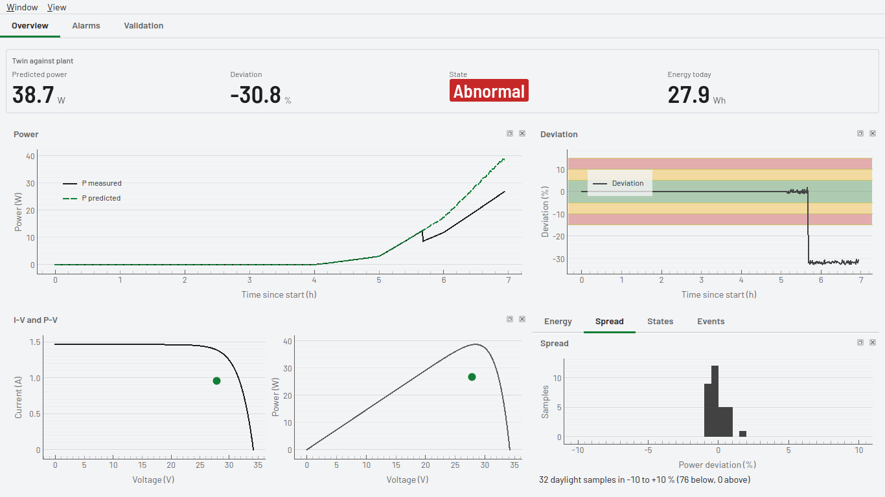

*Figure 12. The Spread tab: a histogram of the daylight power deviation.*

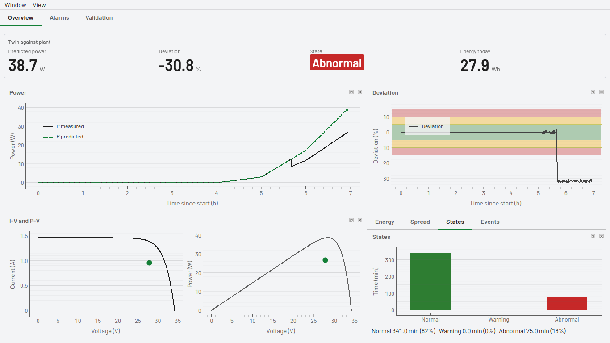

*Figure 13. The States tab: the time spent in Normal, Warning and Abnormal.*

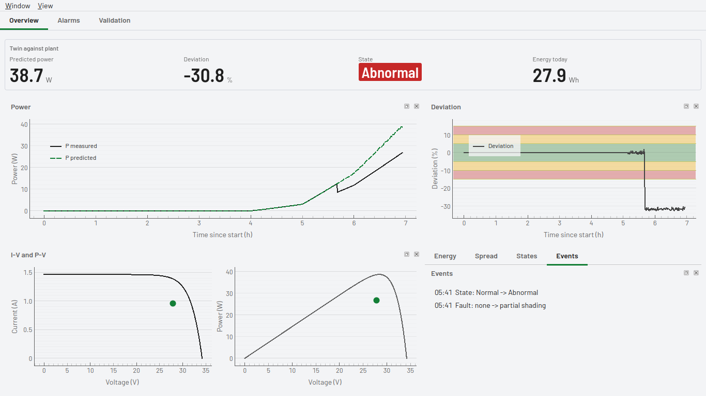

*Figure 14. The Events tab: state changes and fault injections, newest first.*

If you open the Dashboard before a run, it says there is no run in progress and offers **Open HMI**.

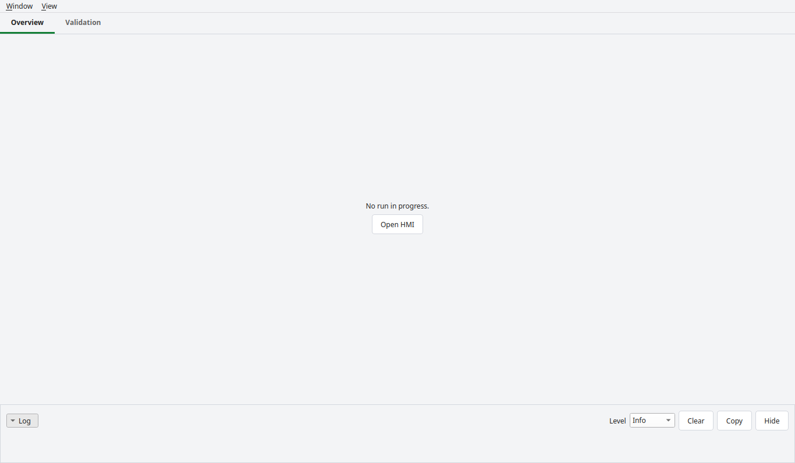

*Figure 15. The Dashboard with no run in progress.*

### 4.2 Rearranging the charts

Every chart dock can be moved. The small button at a dock's top right floats it into a window of its own, which you can drag anywhere, including to another monitor. Double-click the floating window's title bar to dock it again. **View > Panels** lists every chart: tick one to show it, untick it to close it.

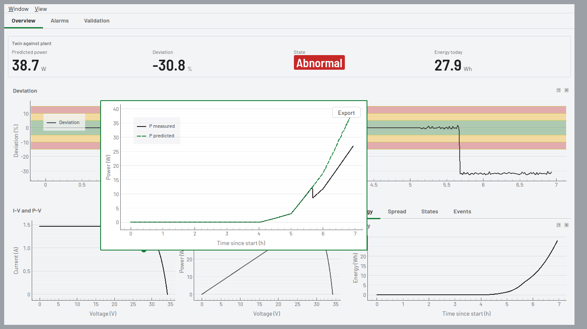

*Figure 16. The Power chart floated out of the Dashboard into its own window.*

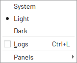

*Figure 17. The View menu on the Dashboard: the theme, Logs and the Panels list that brings a closed chart back.*

### 4.3 Exploring and exporting a chart

Every chart can be explored: the mouse wheel zooms and a drag pans. While the pointer is over a chart, an **Export** button appears at its top right corner. It offers **Image (PNG)...**, **Data (CSV)...** and **Reset view**.

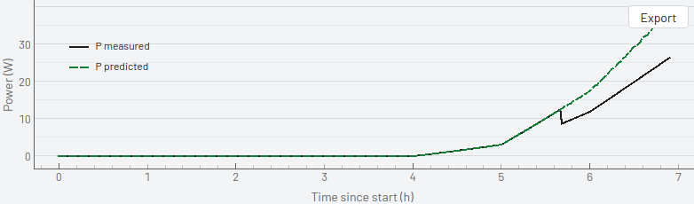

*Figure 18. A Dashboard chart with the Export button showing.*

### 4.4 Alarms

An alarm is raised when the state becomes Warning or Abnormal. The **Alarms** tab lists them newest first, with the time, the state, the deviation and the probable cause. A new alarm is in bold and tinted. Press **Acknowledge** to mark it as seen. Alarms are recorded and logged even when the Dashboard is closed.

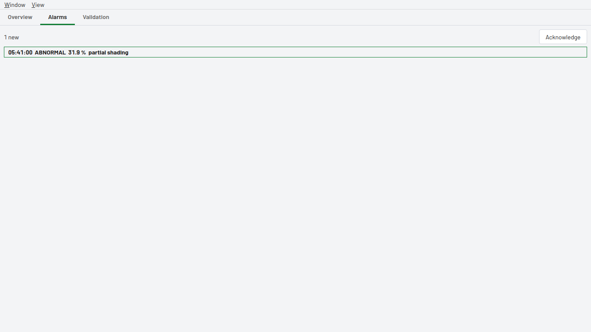

*Figure 19. The Alarms tab with one new Abnormal alarm for partial shading.*

### 4.5 Validation

Validation tests the twin against known answers. It runs one healthy day and one day for each of the five faults. Press **Run validation**.


*Figure 20. The Validation tab before it has run.*


*Figure 21. Validation results: accuracy on healthy data, fault detection, a table for each fault and the confusion matrix.*

| Result | What it tells you |
|---|---|
| **MAE, RMSE, MAPE** | How closely the twin's power matches the healthy plant. Hover the figures for what is excluded. |
| **Detection rate** | The share of fault samples the twin flagged as Abnormal. |
| **Mean delay** | How long after injection the twin noticed. |
| **False alarms** | How often the healthy run was flagged, at your configured limits and at limits derived from the healthy run's own noise. |
| **Each fault** | Whether each of the five faults was detected, how fast, and at what rate. |
| **Twin against truth** | A table of what was true (rows) against what the twin said (columns). Green cells are correct. |

**Export samples CSV...** and **Export metrics CSV...** save the data behind the results.

## 5. The Sensors window

The Sensors window holds everything that comes from the plant's own sensors, apart from the twin. Today the source is the simulated plant. When hardware feeds are added, this is the window where they connect, and the figures and charts here do not change.

### 5.1 Live

**Live** shows the five sensor readings (irradiance, module temperature, voltage, current and measured power) and a chart for each channel. The header says where the readings come from and whether hardware is connected.


*Figure 22. The Sensors window, Live tab: five readings, the irradiance chart, and voltage, current and measured power below.*

Irradiance and module temperature are tabs in one pane.

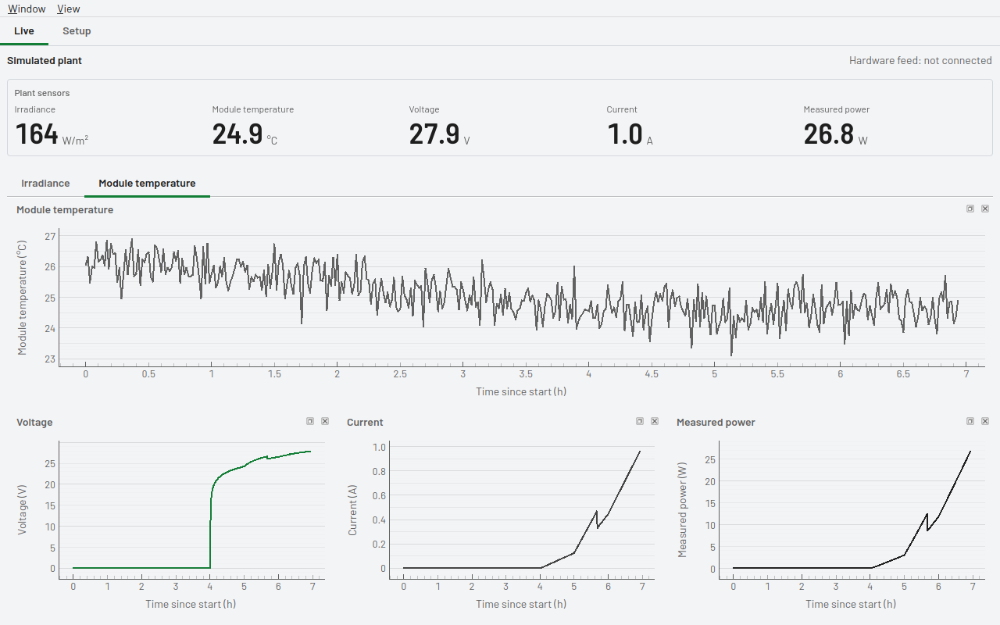

*Figure 23. The Module temperature tab, next to Irradiance in the same pane.*

### 5.2 Setup: the simulated plant

The **Simulated plant** part of Setup sets how far the simulated module differs from the twin's datasheet (the **Rs**, **Rsh** and temperature-coefficient offsets: a larger mismatch makes a larger healthy deviation) and the **Sensor model**: the noise on each sensor, the step size of the voltage and current readings, and the random **Seed**. The same seed gives the same run every time. **Apply and start** starts a new run with this plant.


*Figure 24. Sensors, Setup tab, with the simulated plant as the source. The plant settings are below the source.*

### 5.3 Setup: the source

Choose where the readings come from: the simulated plant, a serial port, an MQTT broker, or an HTTP or WebSocket address. A hardware source shows its connection settings (port and baud rate, host and topic, or an address) and the **Channels**: the field name each reading arrives under.


*Figure 25. A serial port as the source, with its port, baud rate and the four channel names.*

**Connect** checks the settings and names anything missing.


*Figure 26. Connect names what is missing: an MQTT source with no host.*

There is no hardware driver in this version. With valid settings, Connect says so, the header shows "not available yet", and the simulated plant stays the source.

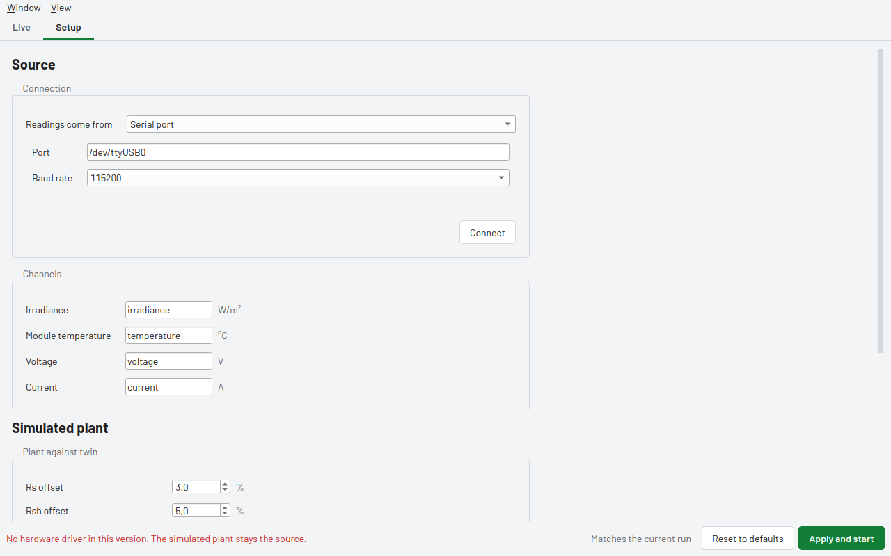

*Figure 27. Connect with valid serial settings: no driver yet, so the header says the feed is not available.*

## 6. Setting up a run

Open the HMI's **Setup** tab. The sections are listed on the left. Click one to see its page.

Nothing changes until you press **Apply and start**. The bar along the bottom shows whether your edits differ from the current run ("Matches the current run" or "Changes not applied yet"). It also holds three buttons:

| Button | What it does |
|---|---|
| **Validate setup** | Checks every value and reports problems. It starts nothing. |
| **Reset to defaults** | Puts every control back to its default. It applies nothing. |
| **Apply and start** | Checks the setup and starts a new run from the beginning. |

Each number field holds only the number. Its unit is the grey label beside it.

### 6.1 Profile

The profile is the day of irradiance and temperature that drives the run.

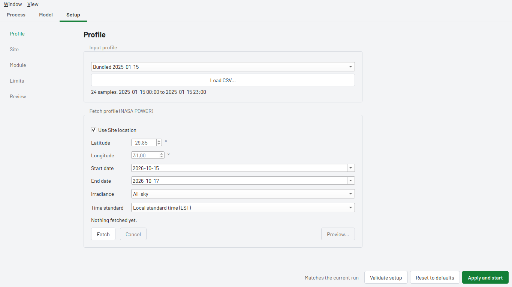

*Figure 28. Setup, Profile: the bundled days, Load CSV, and the NASA POWER fetch.*

- Choose a bundled day from the list, or press **Load CSV or Excel...** for your own file (**Template...** saves an empty weather file to fill in) ([section 7](#7-loading-your-own-data)).
- **Fetch profile (NASA POWER)** downloads real data for a place and dates. Tick **Use Site location** to use the latitude and longitude from the Site page, or untick it to type your own. Choose the start and end dates, the irradiance type and the time standard, then press **Fetch**. **Preview...** shows the fetched data before you use it. Fetches are cached, so a repeat fetch works offline.

### 6.2 Site

Where the plant is (latitude, longitude, tilt and azimuth). It labels the run and sets the default fetch position. It does not change the physics.

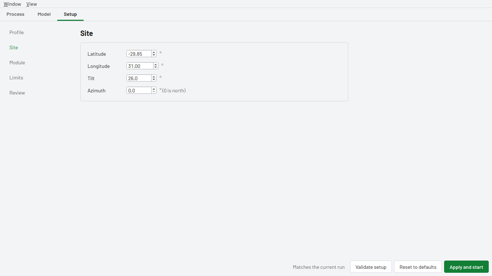

*Figure 29. Setup, Site.*

### 6.3 Module

The datasheet the twin predicts with: Isc, Voc, Impp, Vmpp, the temperature coefficients Ki and Kv, and the cell count Ns. Edit any value, press **Load datasheet...** to read a file (Excel, CSV, JSON or TOML), press **Datasheet template...** to save an empty one to fill in, or press **Reset to generic module** to return to the generic 60-cell 250 W module.

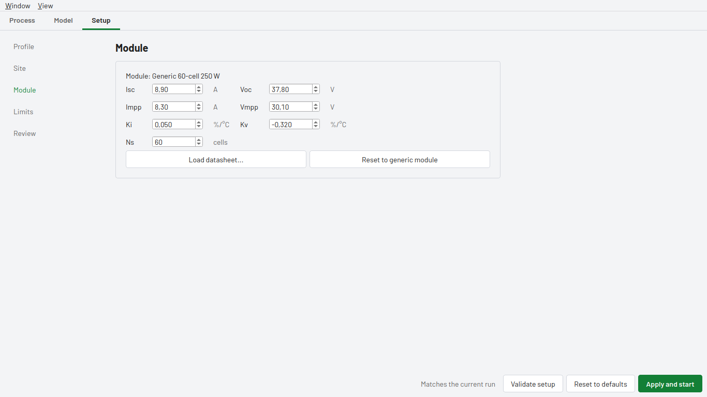

*Figure 30. Setup, Module.*

### 6.4 Limits

The warning and abnormal limits, in percent. **Derive from healthy run** sets them from a healthy simulated day: the mean deviation plus two and three standard deviations.

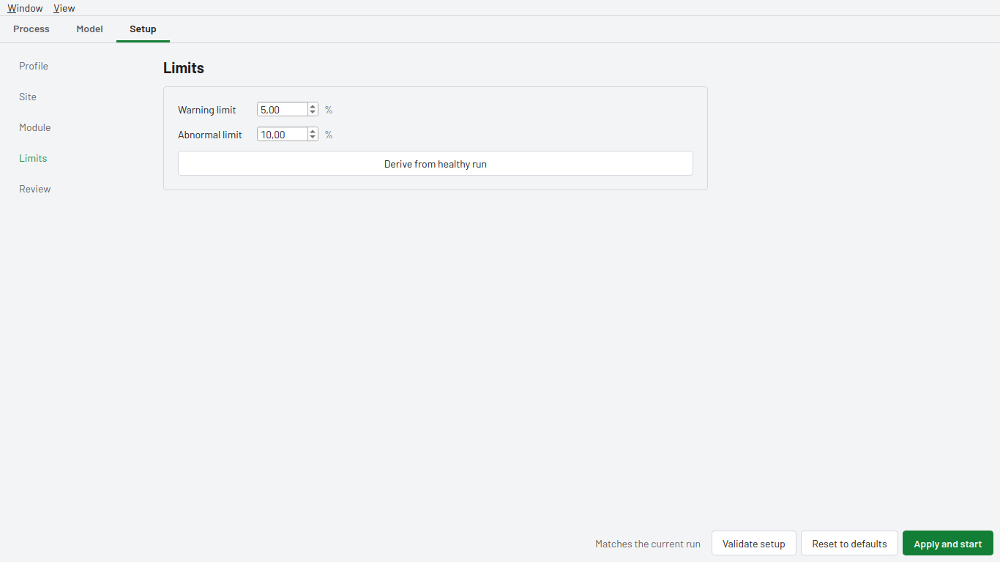

*Figure 31. Setup, Limits.*

### 6.5 Review

A summary of what the next run will use. Check it, then press **Apply and start**.

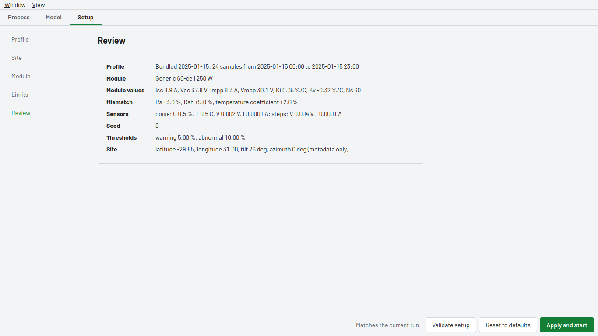

*Figure 32. Setup, Review: what the next run will use.*

## 7. Loading your own data

Press **Load CSV or Excel...** on the Profile page and choose a file. **Template...** saves an empty weather file, as Excel or CSV, to start from. The file is a `.csv` or an `.xlsx` and needs a header row, a timestamp column, an irradiance column (W/m²) and a temperature column (°C).


*Figure 33. The CSV dialog: the column choices, the first rows of the file and the result of the checks.*

1. The dialog guesses each column from its name. Change a choice if it is wrong. NASA POWER files with `YEAR, MO, DY, HR` columns are recognised.
2. The **first rows** table shows what the file holds.
3. The check line gives the number of rows, the date range and the time step, or says **Rejected** with the reason.
4. **Use profile** is enabled only when the file passes. Press it, then **Apply and start**. **Cancel** keeps the previous profile.

A file is rejected if its times do not increase by one fixed step, any value is missing or not a number, or irradiance is negative.

When you fetch from NASA POWER, **Preview...** opens the fetched profile for inspection before it is used.


*Figure 34. The fetch preview: the fetched irradiance and temperature, with statistics and checks, before you use or discard it.*

## 8. Themes and the log

**Themes.** The app follows your system's light or dark setting. In the **View** menu, choose **System**, **Light** or **Dark** to override it. The look is flat: no boxes, only type, space and thin rules.

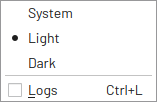

*Figure 35. The View menu on the HMI: the theme choices and Logs.*

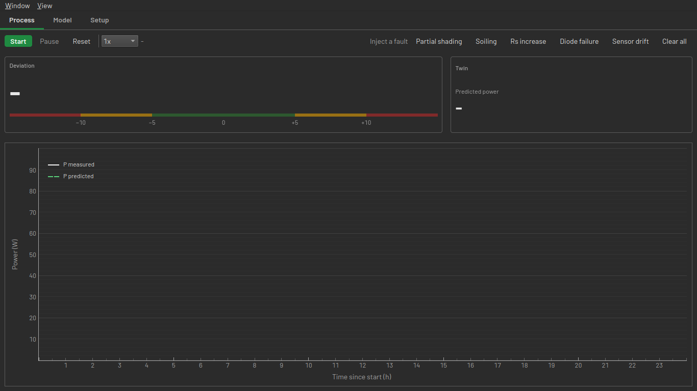

*Figure 36. The same Process tab in the dark theme.*

**The log.** Open it from **View > Logs** (Ctrl+L). It is a pop-up window, so it takes no room until you ask for it; close it with its close button. It lists what the app is doing as time, level and message.

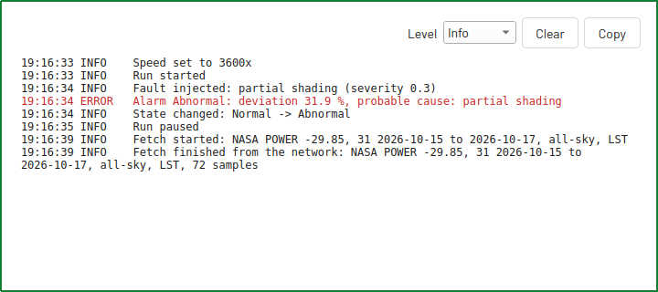

*Figure 37. The log pop-up: a fault injected, an Abnormal alarm in red, and the state change.*

- **Level** filters by Debug, Info, Warning or Error. Warnings are amber and errors are red.
- **Clear** empties it, and **Copy** puts the visible lines on the clipboard.

Every window has its own pop-up, and all of them show the same log.

## 9. Quick recipes

**Watch a fault being caught**

1. Run `uv run pvysics`.
2. In the HMI, set the speed to `600x` and press **Start**.
3. Once the plant output has risen, click **Partial shading**.
4. Watch the deviation figure and rail and the state. The Dashboard shows the same event, and the Alarms tab lists the alarm.

**Run on real weather**

1. Setup > Site: enter the plant's latitude and longitude.
2. Setup > Profile: pick dates, press **Fetch**, press **Preview...**, then **Use**.
3. Press **Apply and start**.

**Check the twin's accuracy**

1. Open the Dashboard and go to **Validation**.
2. Press **Run validation** and read the figures and tables.
3. Use **Export metrics CSV...** to keep the numbers.

**Try a noisier plant**

1. In the Sensors window, open **Setup**.
2. Raise the **Irradiance noise** or the **Rs offset**.
3. Press **Apply and start** and watch the deviation on the HMI.

**Start over**

HMI Setup > **Reset to defaults**, then **Apply and start**. For the plant, use **Reset to defaults** in the Sensors window's Setup.

## 10. Troubleshooting

| Problem | What to do |
|---|---|
| The Dashboard says "No run in progress". | Press **Open HMI** and start a run there. |
| A CSV is rejected. | Read the reason in the dialog. Check that the columns are mapped right and the times step evenly with no gaps. |
| A fetch fails. | NASA POWER needs an internet connection. The log has the reason. A date range you fetched before still loads from the cache. |
| The state stays Normal after injecting a fault. | At night there is too little light to compare, so no state is shown. Run on until the sun is up. |
| Changes on Setup have no effect. | Press **Apply and start**. Edits apply only then. |
| The log is not showing. | It is a pop-up: **View > Logs** (Ctrl+L). On the Dashboard, a closed chart comes back from **View > Panels**. |
| Connect says there is no hardware driver. | Hardware feeds are not available in this version. The simulated plant stays the source. |
