# PV Digital Twin: UI wireframes

Two separate UIs share one data bus. The **HMI** is the interactive demo of the plant and twin. The **dashboard** is read-only analytics.

## Navigation and data flow

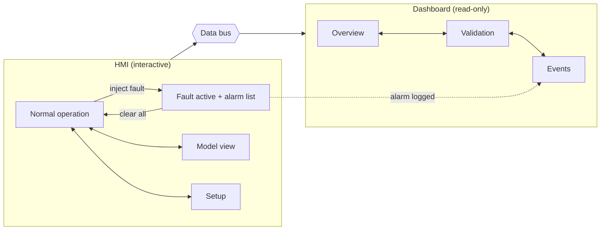

## Setup and configuration flow

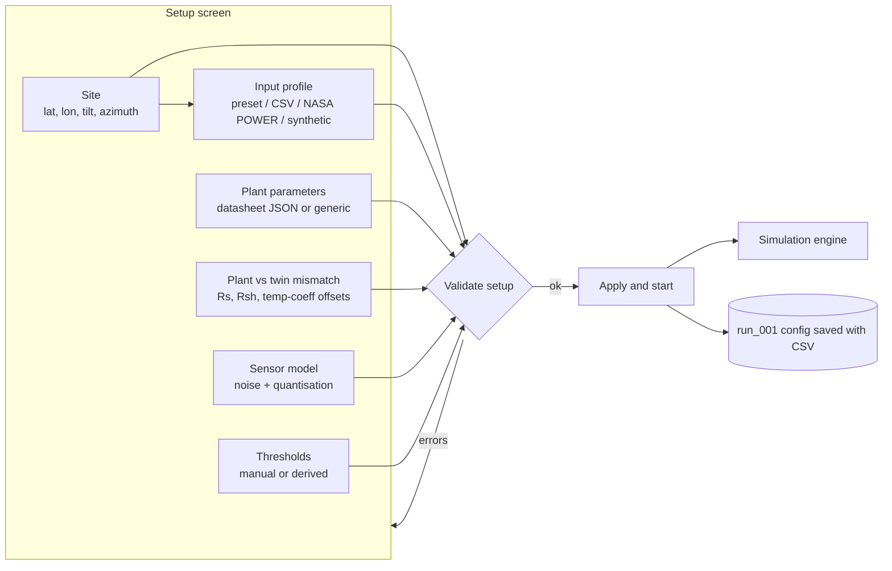

Profile CSV: `timestamp, G, T` (G in W/m2, T in C). Datasheet JSON:
`{"Isc", "Voc", "Impp", "Vmpp", "Ki", "Kv", "Ns"}`.


## Layout blocks

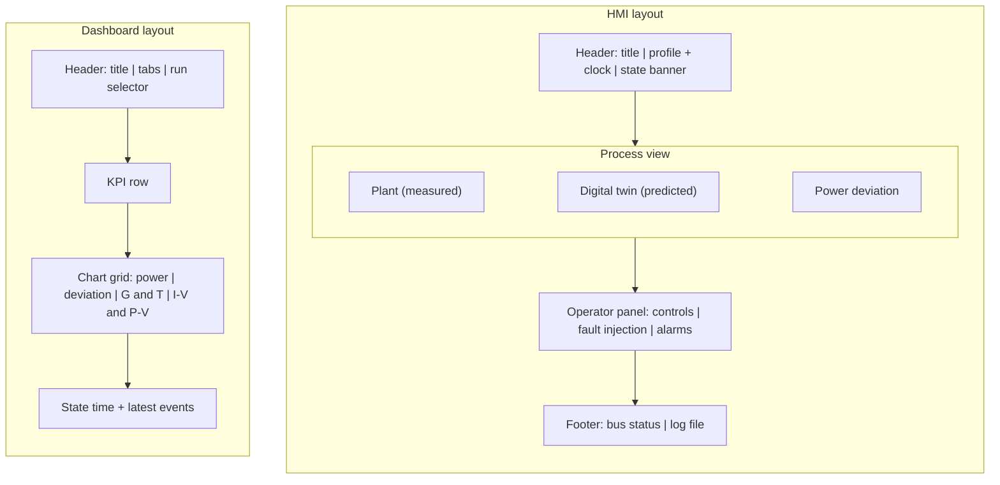

## The model

The twin is the Single Diode Model. The HMI model view shows this circuit, its equations and its live parameters.

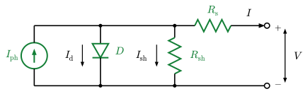

$$I = I_{ph} - I_0\left(e^{\frac{V + I R_s}{n N_s V_t}} - 1\right) - \frac{V + I R_s}{R_{sh}}$$

$$I_{ph} = \frac{G}{G_{ref}}\left[I_{sc} + K_i\,(T - T_{ref})\right], \qquad V_t = \frac{kT}{q}$$

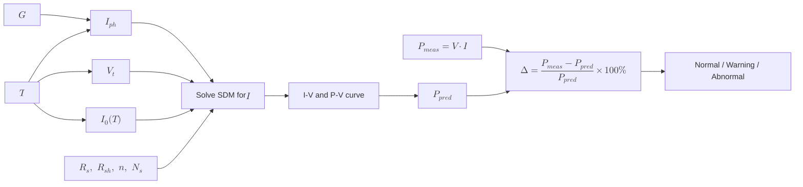

## HMI: normal operation

Plant and twin side by side. The deviation panel sits between the two, and the operator controls and fault buttons run along the bottom.

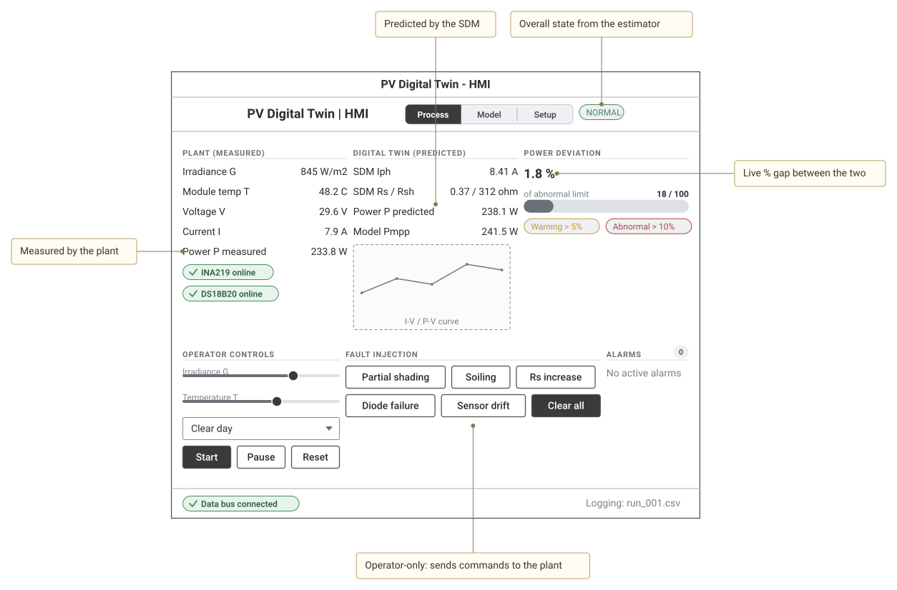

<details><summary>Wireloom source</summary>

```wireloom
window "PV Digital Twin - HMI":
  header:
    row justify=between:
      text "PV Digital Twin  |  HMI" bold size=large
      segmented:
        segment "Process" selected
        segment "Model"
        segment "Setup"
      chip "NORMAL" accent=success id="banner"
  row:
    col:
      section "PLANT (measured)":
        kv "Irradiance G" "845 W/m2"
        kv "Module temp T" "48.2 C"
        kv "Voltage V" "29.6 V"
        kv "Current I" "7.9 A"
        kv "Power P measured" "233.8 W" id="pmeas"
        status "INA219 online" kind=success
        status "DS18B20 online" kind=success
    col:
      section "DIGITAL TWIN (predicted)":
        kv "SDM Iph" "8.41 A"
        kv "SDM Rs / Rsh" "0.37 / 312 ohm"
        kv "Power P predicted" "238.1 W" id="ppred"
        kv "Model Pmpp" "241.5 W"
        chart kind=line label="I-V / P-V curve" id="ivcurve"
    col:
      section "POWER DEVIATION":
        text "1.8 %" bold size=large id="dev"
        progress value=18 max=100 label="of abnormal limit"
        row:
          chip "Warning > 5%" accent=warning
          chip "Abnormal > 10%" accent=danger
  row:
    section "OPERATOR CONTROLS":
      slider label="Irradiance G" range=0-1200 value=845 id="gslider"
      slider label="Temperature T" range=0-80 value=48
      combo "Profile" value="Clear day"
      row:
        button "Start" primary
        button "Pause"
        button "Reset"
    section "FAULT INJECTION" id="faults":
      row:
        button "Partial shading"
        button "Soiling"
        button "Rs increase"
      row:
        button "Diode failure"
        button "Sensor drift"
        button "Clear all" primary
    section "ALARMS" badge="0":
      text "No active alarms" muted
  footer:
    row justify=between:
      status "Data bus connected" kind=success
      text "Logging: run_001.csv" muted

annotation "Overall state from the estimator" target="banner" position=top
annotation "Measured by the plant" target="pmeas" position=left
annotation "Predicted by the SDM" target="ppred" position=top
annotation "Live % gap between the two" target="dev" position=right
annotation "Operator-only: sends commands to the plant" target="faults" position=bottom
```

</details>

## HMI: fault injected

Same screen after partial shading is injected. The banner, deviation panel and alarm list all react.

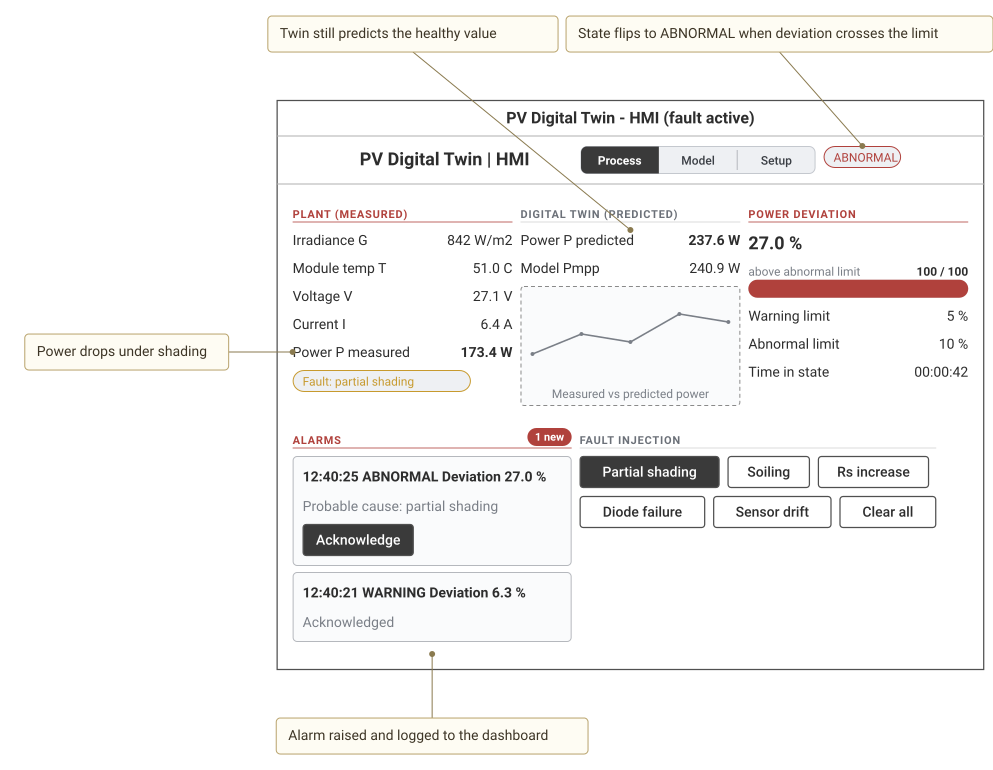

<details><summary>Wireloom source</summary>

```wireloom
window "PV Digital Twin - HMI (fault active)":
  header:
    row justify=between:
      text "PV Digital Twin  |  HMI" bold size=large
      segmented:
        segment "Process" selected
        segment "Model"
        segment "Setup"
      chip "ABNORMAL" accent=danger id="banner"
  row:
    col:
      section "PLANT (measured)" accent=danger:
        kv "Irradiance G" "842 W/m2"
        kv "Module temp T" "51.0 C"
        kv "Voltage V" "27.1 V"
        kv "Current I" "6.4 A"
        kv "Power P measured" "173.4 W" bold id="pmeas"
        chip "Fault: partial shading" accent=warning id="fault"
    col:
      section "DIGITAL TWIN (predicted)":
        kv "Power P predicted" "237.6 W" bold id="ppred"
        kv "Model Pmpp" "240.9 W"
        chart kind=line label="Measured vs predicted power"
    col:
      section "POWER DEVIATION" accent=danger:
        text "27.0 %" bold size=large id="dev"
        progress value=100 max=100 label="above abnormal limit" accent=danger
        kv "Warning limit" "5 %"
        kv "Abnormal limit" "10 %"
        kv "Time in state" "00:00:42"
  row:
    section "ALARMS" badge="1 new" accent=danger id="alarms":
      list:
        slot "12:40:25  ABNORMAL  Deviation 27.0 %":
          text "Probable cause: partial shading" muted
          button "Acknowledge" primary
        slot "12:40:21  WARNING  Deviation 6.3 %":
          text "Acknowledged" muted
    section "FAULT INJECTION":
      row:
        button "Partial shading" primary
        button "Soiling"
        button "Rs increase"
      row:
        button "Diode failure"
        button "Sensor drift"
        button "Clear all"

annotation "State flips to ABNORMAL when deviation crosses the limit" target="banner" position=top
annotation "Power drops under shading" target="pmeas" position=left
annotation "Twin still predicts the healthy value" target="ppred" position=top
annotation "Alarm raised and logged to the dashboard" target="alarms" position=bottom
```

</details>

## HMI: model view

The Single Diode Model on screen: equivalent circuit, equations, editable parameters, live inputs and the resulting curve.

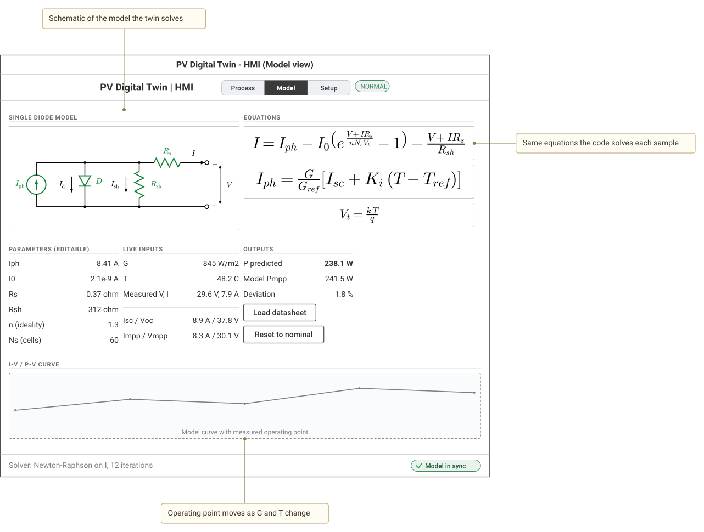

<details><summary>Wireloom source</summary>

```wireloom
window "PV Digital Twin - HMI (Model view)":
  header:
    row justify=between:
      text "PV Digital Twin  |  HMI" bold size=large
      segmented:
        segment "Process"
        segment "Model" selected
        segment "Setup"
      chip "NORMAL" accent=success
  row:
    section "SINGLE DIODE MODEL" id="circuit":
      image label="Circuit: SDM schematic" width=420 height=190
    section "EQUATIONS" id="eqs":
      image label="Typeset SDM equation" width=420 height=62 id="eq"
      image label="Typeset Iph equation" width=420 height=62
      image label="Typeset Vt equation" width=420 height=44
  row:
    section "PARAMETERS (editable)":
      kv "Iph" "8.41 A"
      kv "I0" "2.1e-9 A"
      kv "Rs" "0.37 ohm"
      kv "Rsh" "312 ohm"
      kv "n (ideality)" "1.3"
      kv "Ns (cells)" "60"
    section "LIVE INPUTS":
      kv "G" "845 W/m2"
      kv "T" "48.2 C"
      kv "Measured V, I" "29.6 V, 7.9 A"
      divider
      kv "Isc / Voc" "8.9 A / 37.8 V"
      kv "Impp / Vmpp" "8.3 A / 30.1 V"
    section "OUTPUTS":
      kv "P predicted" "238.1 W" bold
      kv "Model Pmpp" "241.5 W"
      kv "Deviation" "1.8 %"
      button "Load datasheet"
      button "Reset to nominal"
  row:
    section "I-V / P-V CURVE":
      chart kind=line label="Model curve with measured operating point" id="curve" width=860 height=120
  footer:
    row justify=between:
      text "Solver: Newton-Raphson on I, 12 iterations" muted
      status "Model in sync" kind=success

annotation "Schematic of the model the twin solves" target="circuit" position=top
annotation "Same equations the code solves each sample" target="eq" position=right
annotation "Operating point moves as G and T change" target="curve" position=bottom
```

</details>

## HMI: setup

Choose or upload the input profile, set the plant and twin parameters, the plant-vs-twin mismatch, sensor noise and thresholds, then apply.

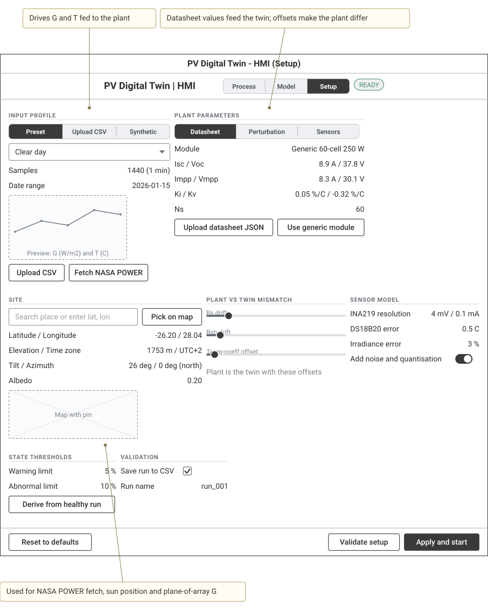

<details><summary>Wireloom source</summary>

```wireloom
window "PV Digital Twin - HMI (Setup)":
  header:
    row justify=between:
      text "PV Digital Twin  |  HMI" bold size=large
      segmented:
        segment "Process"
        segment "Model"
        segment "Setup" selected
      chip "READY" accent=success
  row:
    section "INPUT PROFILE" id="profile":
      segmented:
        segment "Preset" selected
        segment "Upload CSV"
        segment "Synthetic"
      combo "Preset" value="Clear day" options="Clear day,Cloudy day,Hot day,Winter day"
      kv "Samples" "1440 (1 min)"
      kv "Date range" "2026-01-15"
      chart kind=line label="Preview: G (W/m2) and T (C)" id="preview"
      row:
        button "Upload CSV"
        button "Fetch NASA POWER"
    section "PLANT PARAMETERS" id="plant":
      segmented:
        segment "Datasheet" selected
        segment "Perturbation"
        segment "Sensors"
      kv "Module" "Generic 60-cell 250 W"
      kv "Isc / Voc" "8.9 A / 37.8 V"
      kv "Impp / Vmpp" "8.3 A / 30.1 V"
      kv "Ki / Kv" "0.05 %/C / -0.32 %/C"
      kv "Ns" "60"
      row:
        button "Upload datasheet JSON"
        button "Use generic module"
  row:
    section "SITE" id="site":
      row:
        input placeholder="Search place or enter lat, lon"
        button "Pick on map"
      kv "Latitude / Longitude" "-26.20 / 28.04"
      kv "Elevation / Time zone" "1753 m / UTC+2"
      kv "Tilt / Azimuth" "26 deg / 0 deg (north)"
      kv "Albedo" "0.20"
      image label="Map with pin" width=240 height=90
    section "PLANT vs TWIN MISMATCH":
      slider label="Rs drift" range=0-50 value=8
      slider label="Rsh drift" range=0-50 value=5
      slider label="Temp-coeff offset" range=0-50 value=3
      text "Plant is the twin with these offsets" muted
    section "SENSOR MODEL":
      kv "INA219 resolution" "4 mV / 0.1 mA"
      kv "DS18B20 error" "0.5 C"
      kv "Irradiance error" "3 %"
      toggle "Add noise and quantisation" on
  row:
    section "STATE THRESHOLDS":
      kv "Warning limit" "5 %"
      kv "Abnormal limit" "10 %"
      button "Derive from healthy run"
    section "VALIDATION":
      checkbox "Save run to CSV" checked
      kv "Run name" "run_001"
  footer:
    row justify=between:
      button "Reset to defaults"
      row:
        button "Validate setup"
        button "Apply and start" primary

annotation "Used for NASA POWER fetch, sun position and plane-of-array G" target="site" position=bottom
annotation "Drives G and T fed to the plant" target="profile" position=top
annotation "Datasheet values feed the twin; offsets make the plant differ" target="plant" position=top
```

</details>

## HMI: upload dialog

Upload a profile CSV, map columns and see validation checks before use.

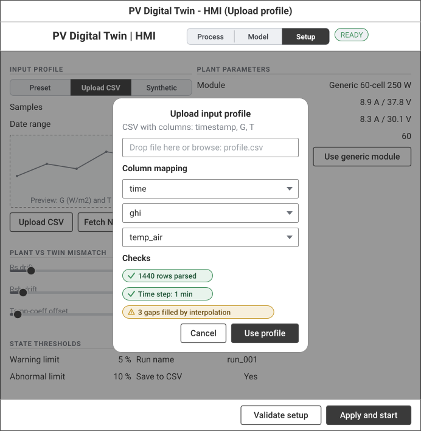

<details><summary>Wireloom source</summary>

```wireloom
window "PV Digital Twin - HMI (Upload profile)":
  header:
    row justify=between:
      text "PV Digital Twin  |  HMI" bold size=large
      segmented:
        segment "Process"
        segment "Model"
        segment "Setup" selected
      chip "READY" accent=success
  row:
    section "INPUT PROFILE":
      segmented:
        segment "Preset"
        segment "Upload CSV" selected
        segment "Synthetic"
      kv "Samples" "1440 (1 min)"
      kv "Date range" "2026-01-15"
      chart kind=line label="Preview: G (W/m2) and T (C)"
      row:
        button "Upload CSV"
        button "Fetch NASA POWER"
    section "PLANT PARAMETERS":
      kv "Module" "Generic 60-cell 250 W"
      kv "Isc / Voc" "8.9 A / 37.8 V"
      kv "Impp / Vmpp" "8.3 A / 30.1 V"
      kv "Ns" "60"
      row:
        button "Upload datasheet JSON"
        button "Use generic module"
  row:
    section "PLANT vs TWIN MISMATCH":
      slider label="Rs drift" range=0-50 value=8
      slider label="Rsh drift" range=0-50 value=5
      slider label="Temp-coeff offset" range=0-50 value=3
    section "SENSOR MODEL":
      kv "INA219 resolution" "4 mV / 0.1 mA"
      kv "DS18B20 error" "0.5 C"
      kv "Irradiance error" "3 %"
  row:
    section "STATE THRESHOLDS":
      kv "Warning limit" "5 %"
      kv "Abnormal limit" "10 %"
    section "VALIDATION":
      kv "Run name" "run_001"
      kv "Save to CSV" "Yes"
  footer:
    row justify=end:
      button "Validate setup"
      button "Apply and start" primary
  sheet position=center title="Upload input profile":
    text "CSV with columns: timestamp, G, T" muted
    input placeholder="Drop file here or browse: profile.csv"
    text "Column mapping" bold
    combo "timestamp" value="time"
    combo "G (W/m2)" value="ghi"
    combo "T (C)" value="temp_air"
    text "Checks" bold
    status "1440 rows parsed" kind=success
    status "Time step: 1 min" kind=success
    status "3 gaps filled by interpolation" kind=warning
    row justify=end:
      button "Cancel"
      button "Use profile" primary
```

</details>

## Dashboard: overview

Read-only KPIs and trends for a selected run.

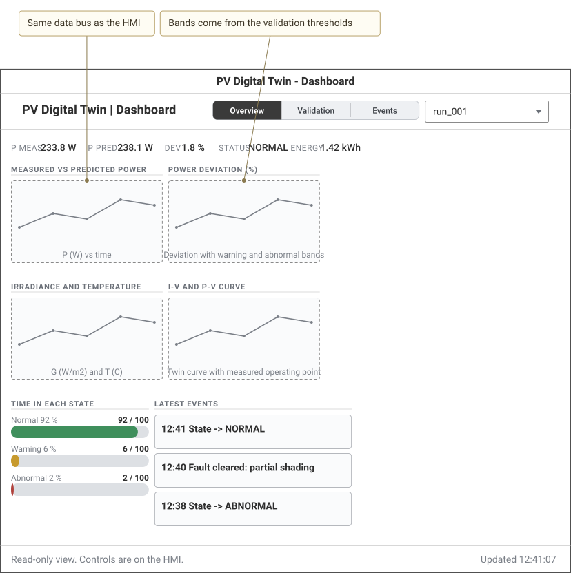

<details><summary>Wireloom source</summary>

```wireloom
window "PV Digital Twin - Dashboard":
  header:
    row justify=between:
      text "PV Digital Twin  |  Dashboard" bold size=large
      segmented:
        segment "Overview" selected
        segment "Validation"
        segment "Events"
      combo "Run" value="run_001"
  stats:
    stat "P meas" "233.8 W"
    stat "P pred" "238.1 W"
    stat "Dev" "1.8 %"
    stat "Status" "NORMAL"
    stat "Energy" "1.42 kWh"
  row:
    section "Measured vs predicted power":
      chart kind=line label="P (W) vs time" id="pchart"
    section "Power deviation (%)":
      chart kind=line label="Deviation with warning and abnormal bands" id="devchart"
  row:
    section "Irradiance and temperature":
      chart kind=line label="G (W/m2) and T (C)"
    section "I-V and P-V curve":
      chart kind=line label="Twin curve with measured operating point"
  row:
    section "Time in each state":
      progress value=92 max=100 label="Normal 92 %" accent=success
      progress value=6 max=100 label="Warning 6 %" accent=warning
      progress value=2 max=100 label="Abnormal 2 %" accent=danger
    section "Latest events":
      list:
        slot "12:41  State -> NORMAL"
        slot "12:40  Fault cleared: partial shading"
        slot "12:38  State -> ABNORMAL"
  footer:
    row justify=between:
      text "Read-only view. Controls are on the HMI." muted
      text "Updated 12:41:07" muted

annotation "Same data bus as the HMI" target="pchart" position=top
annotation "Bands come from the validation thresholds" target="devchart" position=top
```

</details>

## Dashboard: validation

MAE, RMSE and MAPE for the healthy case, plus fault-detection results.

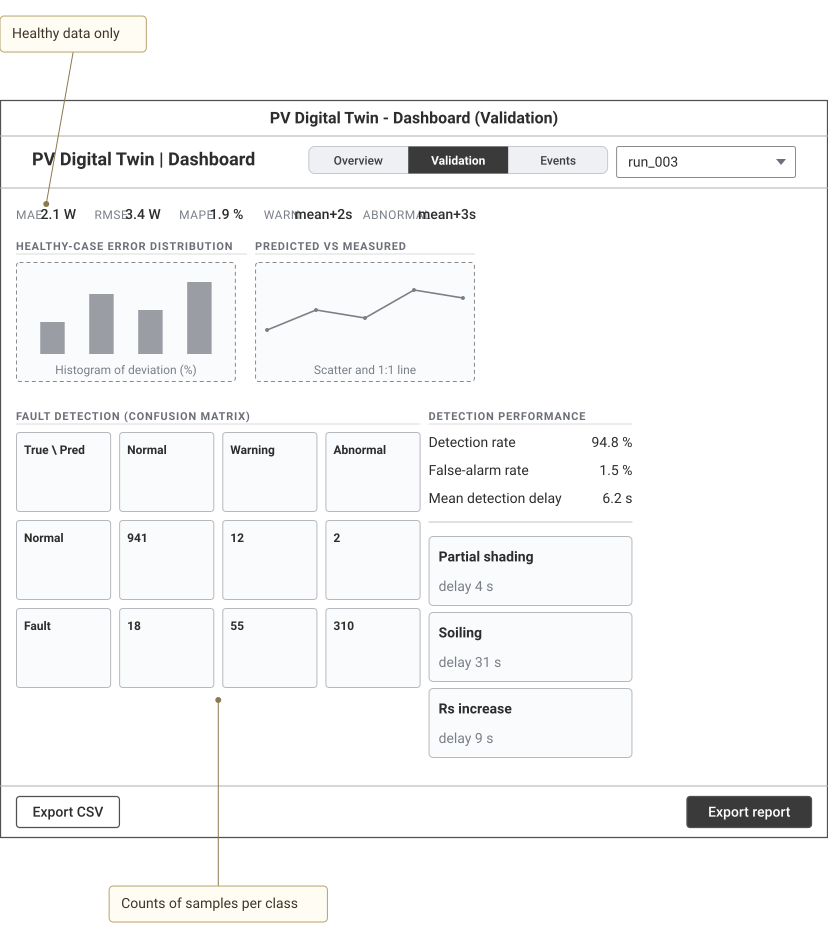

<details><summary>Wireloom source</summary>

```wireloom
window "PV Digital Twin - Dashboard (Validation)":
  header:
    row justify=between:
      text "PV Digital Twin  |  Dashboard" bold size=large
      segmented:
        segment "Overview"
        segment "Validation" selected
        segment "Events"
      combo "Run" value="run_003"
  stats:
    stat "MAE" "2.1 W" id="mae"
    stat "RMSE" "3.4 W"
    stat "MAPE" "1.9 %"
    stat "Warn" "mean+2s"
    stat "Abnormal" "mean+3s"
  row:
    section "Healthy-case error distribution":
      chart kind=bar label="Histogram of deviation (%)"
    section "Predicted vs measured":
      chart kind=line label="Scatter and 1:1 line"
  row:
    section "Fault detection (confusion matrix)" id="cm":
      grid cols=4 rows=3:
        cell "True \\ Pred"
        cell "Normal"
        cell "Warning"
        cell "Abnormal"
        cell "Normal"
        cell "941"
        cell "12"
        cell "2"
        cell "Fault"
        cell "18"
        cell "55"
        cell "310"
    section "Detection performance":
      kv "Detection rate" "94.8 %"
      kv "False-alarm rate" "1.5 %"
      kv "Mean detection delay" "6.2 s"
      divider
      list:
        slot "Partial shading":
          text "delay 4 s" muted
        slot "Soiling":
          text "delay 31 s" muted
        slot "Rs increase":
          text "delay 9 s" muted
  footer:
    row justify=between:
      button "Export CSV"
      button "Export report" primary

annotation "Healthy data only" target="mae" position=top
annotation "Counts of samples per class" target="cm" position=bottom
```

</details>
